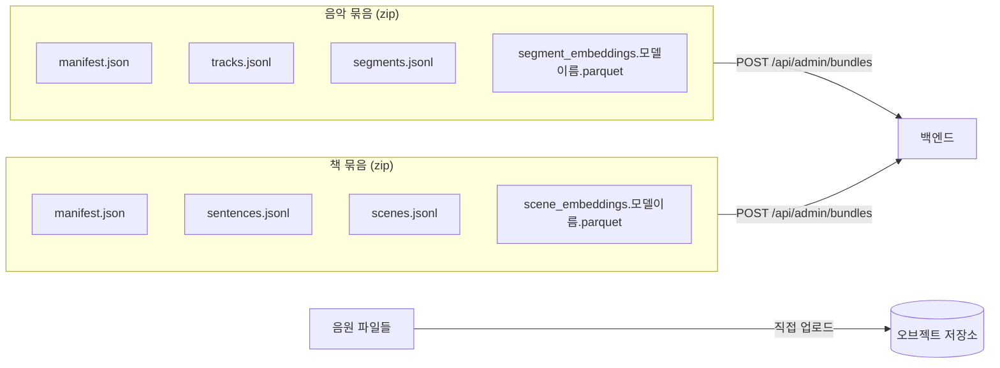

# AI 산출물 묶음 규격

이 문서는 AI 레포와 백엔드 사이의 유일한 약속인 산출물 묶음의 형식을 정의합니다. 이 방식을 고른 이유는 [ADR-004](ADR.md#adr-004-ai-레포와-백엔드의-연동-방식)에, 묶음이 적재되는 과정은 [ARCHITECTURE.md](ARCHITECTURE.md#5-산출물-묶음을-적재하는-흐름)에, 낯선 용어의 뜻은 [GLOSSARY.md](GLOSSARY.md)에 있습니다.

> **이 규격은 아직 백엔드가 제안한 초안입니다.** AI 레포가 비어 있는 상태에서 먼저 작성했으므로, AI팀과 논의하면서 바뀔 수 있습니다. 합의가 필요한 항목은 이 문서의 마지막 절에 모아 두었습니다.

## 1. 전체 그림

AI 레포는 두 종류의 묶음을 만듭니다. 하나는 음악 묶음이고, 다른 하나는 책 묶음입니다. 두 묶음은 서로 독립적이어서 따로 올릴 수 있습니다. 다만 책 묶음의 장면이 특정 곡을 지정 곡으로 가리킨다면, 그 곡이 담긴 음악 묶음을 먼저 올려야 합니다.



## 2. 공통 규칙

- 묶음은 zip 파일 하나이며, 파일들은 zip의 최상위에 둡니다.
- 모든 묶음에는 `manifest.json`이 있어야 합니다. 이 파일은 묶음의 종류와 그 안에 든 파일들을 알려 주는 목차입니다.
- 목록 형태의 데이터는 JSONL 형식으로 씁니다. JSONL은 한 줄에 JSON 객체 하나를 적는 형식입니다.
- 벡터는 Parquet 형식으로 씁니다. Parquet는 표 형태의 데이터를 열 단위로 압축해 저장하는 파일 형식이며, Python에서는 pandas나 pyarrow로 쉽게 만들 수 있습니다.
- 모든 글자는 UTF-8로 인코딩합니다.
- ID는 AI 레포가 부여하며, 같은 대상에는 다시 만들어도 같은 ID가 붙어야 합니다. 예를 들어 같은 곡을 다시 처리하더라도 곡 ID는 바뀌지 않아야 합니다.

### 벡터에 대한 규칙

- 벡터의 값은 32비트 실수(float32)로 저장합니다.
- 벡터는 길이가 1이 되도록 정규화(L2 정규화)해서 저장합니다.
- 같은 임베딩 모델로 만든 벡터끼리만 비교할 수 있습니다. 그러므로 장면의 벡터와 음악 구간의 벡터는 반드시 같은 이름의 모델로 만들어야 하며, 파일 이름에 모델 이름을 넣어 구분합니다.
- 묶음에 등장하는 모델 이름을 백엔드가 처음 본다면, 백엔드는 `manifest.json`에 적힌 이름과 차원으로 그 모델을 자동으로 등록합니다. 반면에 이미 등록된 모델이라면 차원이 등록된 값과 같아야 하며, 다르면 적재가 실패합니다.
- 한 묶음에 여러 모델의 벡터를 함께 담을 수 있습니다. 예를 들어 MuQ-MuLan의 벡터 파일과 LAION-CLAP의 벡터 파일을 나란히 넣으면 됩니다.

## 3. 음악 묶음

### 3.1 `manifest.json`

| 필드 | 설명 |
| --- | --- |
| `bundle_type` | 음악 묶음이므로 `"music"`입니다. |
| `schema_version` | 이 규격의 버전입니다. 현재는 `1`입니다. |
| `created_at` | 묶음을 만든 시각입니다. |
| `embedding_models` | 이 묶음에 벡터가 들어 있는 모델들의 이름과 차원입니다. |
| `files` | 묶음 안의 파일 이름들입니다. `embeddings`는 모델 이름별로 벡터 파일의 이름을 적습니다. |

```json
{
  "bundle_type": "music",
  "schema_version": 1,
  "created_at": "2026-11-24T09:00:00Z",
  "embedding_models": [
    { "name": "muq-mulan", "dim": 512 },
    { "name": "laion-clap-music", "dim": 512 }
  ],
  "files": {
    "tracks": "tracks.jsonl",
    "segments": "segments.jsonl",
    "embeddings": {
      "muq-mulan": "segment_embeddings.muq-mulan.parquet",
      "laion-clap-music": "segment_embeddings.laion-clap-music.parquet"
    }
  }
}
```

### 3.2 `tracks.jsonl`

한 줄이 곡 하나입니다.

| 필드 | 필수 | 설명 |
| --- | --- | --- |
| `id` | 필수 | 곡의 ID입니다. |
| `title` | 필수 | 곡의 제목입니다. |
| `artist` | 필수 | 아티스트의 이름입니다. |
| `duration_ms` | 필수 | 곡의 길이를 밀리초로 적습니다. |
| `audio_file` | 필수 | 오브젝트 저장소에 올린 음원 파일의 이름입니다. |
| `license` | 필수 | 라이선스의 이름입니다. 현재는 퍼블릭 도메인이거나 저작권의 제약이 없는 음원만 쓰기로 했으므로, `Public Domain`이나 `CC0 1.0`과 같은 값이 들어갑니다. |
| `attribution` | 선택 | 화면에 표시해야 하는 저작자 표기 문구입니다. |
| `source` | 선택 | 음원을 가져온 곳의 이름입니다. |
| `source_url` | 선택 | 음원을 가져온 곳의 주소입니다. |
| `tags` | 선택 | 장르나 분위기 같은 태그의 목록입니다. 평가 자료를 분석할 때 참고합니다. |

```json
{"id": "trk_0042", "title": "Quiet Streets", "artist": "Example Artist", "duration_ms": 184000, "audio_file": "trk_0042.mp3", "license": "CC0 1.0", "source": "Example Archive", "source_url": "https://example.com/track/42", "tags": ["piano", "melancholic"]}
{"id": "trk_0043", "title": "Moonlight Sonata, 1st Movement", "artist": "Example Pianist", "duration_ms": 362000, "audio_file": "trk_0043.mp3", "license": "Public Domain", "source": "Musopen", "tags": ["classical", "piano"]}
```

### 3.3 `segments.jsonl`

한 줄이 구간 하나입니다. 구간의 순서와 길이는 AI 레포가 정합니다.

| 필드 | 필수 | 설명 |
| --- | --- | --- |
| `id` | 필수 | 구간의 ID입니다. |
| `track_id` | 필수 | 이 구간이 속한 곡의 ID입니다. `tracks.jsonl`에 있는 ID여야 합니다. |
| `start_ms` | 필수 | 구간이 시작하는 위치입니다. |
| `end_ms` | 필수 | 구간이 끝나는 위치입니다. `start_ms`보다 커야 하고, 곡의 길이를 넘을 수 없습니다. |

```json
{"id": "trk_0042_s00", "track_id": "trk_0042", "start_ms": 0, "end_ms": 30000}
{"id": "trk_0042_s01", "track_id": "trk_0042", "start_ms": 30000, "end_ms": 60000}
```

### 3.4 `segment_embeddings.<모델 이름>.parquet`

모델마다 파일을 하나씩 만듭니다. 파일은 두 개의 열을 가진 표입니다.

| 열 | 타입 | 설명 |
| --- | --- | --- |
| `id` | 문자열 | 구간의 ID입니다. `segments.jsonl`에 있는 ID여야 합니다. |
| `embedding` | float32의 목록 | 그 구간의 벡터입니다. 길이는 `manifest.json`에 적은 차원과 같아야 합니다. |

내용을 표로 나타내면 다음과 같습니다.

| id | embedding |
| --- | --- |
| `trk_0042_s00` | `[0.0132, -0.0871, 0.0455, …]` (숫자 512개) |
| `trk_0042_s01` | `[0.0098, -0.0794, 0.0512, …]` (숫자 512개) |

그리고 이 파일은 Python에서 다음과 같이 만들 수 있습니다.

```python
import pandas as pd

rows = [
    {"id": "trk_0042_s00", "embedding": vector_a.astype("float32").tolist()},
    {"id": "trk_0042_s01", "embedding": vector_b.astype("float32").tolist()},
]
pd.DataFrame(rows).to_parquet("segment_embeddings.muq-mulan.parquet", index=False)
```

### 3.5 음원 파일

음원 파일은 용량이 크기 때문에 묶음에 넣지 않습니다. 그 대신 오브젝트 저장소에 직접 올리고, `tracks.jsonl`의 `audio_file`에 그 파일의 이름을 적습니다. 오브젝트 저장소에 올리는 방법과 폴더 구조는 인프라가 정해진 뒤에 [INFRA.md](INFRA.md)에 적을 예정입니다.

오브젝트 저장소는 비공개로 두며, 독자는 백엔드가 발급한 서명된 주소로만 음원을 받을 수 있습니다([ARCHITECTURE.md](ARCHITECTURE.md#2-전체-구성)). 따라서 AI 레포는 음원 파일을 누구나 받을 수 있는 공개 상태로 올려서는 안 됩니다. 그리고 현재는 퍼블릭 도메인이거나 저작권의 제약이 없는 음원만 쓰기로 했습니다([DECISIONS.md](DECISIONS.md)의 D-22).

## 4. 책 묶음

### 4.1 `manifest.json`

음악 묶음의 `manifest.json`과 구조가 같고, 책의 정보를 담는 `book` 필드가 더 있습니다.

| `book`의 필드 | 필수 | 설명 |
| --- | --- | --- |
| `id` | 필수 | 책의 ID입니다. 같은 책을 다시 올릴 때에는 같은 ID를 써야 새 버전으로 인식됩니다. |
| `title` | 필수 | 책의 제목입니다. |
| `author` | 선택 | 저자의 이름입니다. |
| `language` | 필수 | 본문의 언어입니다. 한국어는 `"ko"`입니다. |
| `chapters` | 필수 | 챕터의 번호와 제목의 목록입니다. |

```json
{
  "bundle_type": "book",
  "schema_version": 1,
  "created_at": "2026-11-24T09:30:00Z",
  "book": {
    "id": "sample-novel",
    "title": "견본 소설",
    "author": "견본 작가",
    "language": "ko",
    "chapters": [
      { "chapter_no": 1, "title": "제1장" },
      { "chapter_no": 2, "title": "제2장" }
    ]
  },
  "embedding_models": [
    { "name": "muq-mulan", "dim": 512 }
  ],
  "files": {
    "sentences": "sentences.jsonl",
    "scenes": "scenes.jsonl",
    "embeddings": {
      "muq-mulan": "scene_embeddings.muq-mulan.parquet"
    }
  }
}
```

### 4.2 `sentences.jsonl`

한 줄이 문장 하나입니다.

| 필드 | 필수 | 설명 |
| --- | --- | --- |
| `idx` | 필수 | 문장 번호입니다. 0부터 시작하며, 책 전체에서 빠짐없이 1씩 커져야 합니다. |
| `chapter_no` | 필수 | 이 문장이 속한 챕터의 번호입니다. |
| `paragraph_no` | 필수 | 챕터 안에서 이 문장이 속한 문단의 번호입니다. 챕터마다 0부터 다시 시작합니다. |
| `text` | 필수 | 문장의 본문입니다. |

```json
{"idx": 0, "chapter_no": 1, "paragraph_no": 0, "text": "기차가 역을 빠져나가자 창밖으로 낮은 지붕들이 천천히 흘러갔다."}
{"idx": 1, "chapter_no": 1, "paragraph_no": 0, "text": "나는 이마를 유리창에 기댄 채 한동안 아무 생각도 하지 않았다."}
{"idx": 2, "chapter_no": 1, "paragraph_no": 1, "text": "옆자리의 라디오에서 오래된 노래가 작게 흘러나오기 시작했다."}
```

### 4.3 `scenes.jsonl`

한 줄이 장면 하나입니다.

| 필드 | 필수 | 설명 |
| --- | --- | --- |
| `id` | 필수 | 장면의 ID입니다. |
| `start_sentence` | 필수 | 장면이 시작하는 문장의 문장 번호입니다. 이 문장이 트리거 문장입니다. |
| `end_sentence` | 필수 | 장면이 끝나는 문장의 문장 번호입니다. 이 문장도 장면에 포함됩니다. |
| `caption` | 필수 | 이 장면에 어울리는 음악을 묘사한 캡션입니다. 벡터는 이 글로 만듭니다. |
| `is_direct_mention` | 필수 | 본문에 특정 곡이 직접 언급되는 장면이면 `true`입니다. |
| `mentioned` | 선택 | 직접 언급된 곡의 제목과 아티스트입니다. 직접 언급 장면이 아니면 `null`입니다. |
| `designated_track_id` | 선택 | 언급된 바로 그 곡이 우리 음악 목록에 있을 때 그 곡의 ID입니다. 없으면 `null`입니다. |

장면들은 서로 겹치지 않아야 합니다. 그러나 모든 문장이 반드시 어떤 장면에 속해야 하는 것은 아닙니다.

아래 예시의 첫 줄은 분위기만으로 곡을 고르는 일반 장면이고, 둘째 줄은 곡이 직접 언급되지만 그 곡이 우리 목록에는 없는 장면입니다. 둘째 줄의 경우에는 언급된 곡의 분위기를 묘사한 캡션으로 벡터를 만들어서, 비슷한 분위기의 곡이 선곡되게 합니다.

```json
{"id": "scene_0007", "start_sentence": 412, "end_sentence": 455, "caption": "slow, melancholic solo piano, sparse and quiet, sense of loss", "is_direct_mention": false, "mentioned": null, "designated_track_id": null}
{"id": "scene_0001", "start_sentence": 2, "end_sentence": 18, "caption": "gentle 1960s acoustic folk rock, sitar, wistful and nostalgic", "is_direct_mention": true, "mentioned": {"title": "Norwegian Wood (This Bird Has Flown)", "artist": "The Beatles"}, "designated_track_id": null}
```

### 4.4 `scene_embeddings.<모델 이름>.parquet`

구조는 3.4절의 구간 벡터 파일과 같으며, `id` 열에 장면의 ID가 들어갑니다.

| id | embedding |
| --- | --- |
| `scene_0001` | `[0.0211, -0.0345, 0.0672, …]` (숫자 512개) |
| `scene_0007` | `[-0.0154, 0.0823, 0.0091, …]` (숫자 512개) |

## 5. 백엔드가 검증하는 것

백엔드는 묶음을 적재하기 전에 아래 항목을 검사합니다. 하나라도 어긋나면 묶음 전체를 적재하지 않으며, 어긋난 항목들을 오류 목록으로 알려 줍니다. 오류 목록의 형식은 [API.md](API.md#49-관리자-산출물-묶음-적재)에 있습니다.

- `manifest.json`이 있고, 거기에 적힌 파일이 모두 묶음 안에 있는지 검사합니다.
- 필수 필드가 빠지지 않았는지, 값의 타입이 맞는지 검사합니다.
- ID가 한 파일 안에서 중복되지 않는지 검사합니다.
- 구간이 가리키는 곡, 벡터가 가리키는 구간이나 장면이 실제로 있는지 검사합니다.
- 문장 번호가 0부터 빠짐없이 이어지는지 검사합니다.
- 장면의 범위가 실제 문장 번호 안에 있고, 장면끼리 겹치지 않는지 검사합니다.
- 벡터의 길이가 `manifest.json`에 적힌 차원과 같은지 검사합니다. 그리고 이미 등록된 모델이라면 그 차원이 등록된 값과 같은지도 검사합니다.
- 모든 구간과 모든 장면에 대해 벡터가 하나씩 있는지 검사합니다.
- 지정 곡으로 적힌 곡이 이미 적재되어 있는지 검사합니다.

## 6. 같은 것을 다시 올릴 때

- **책 묶음:** `book.id`가 같은 묶음을 다시 올리면 기존 내용을 지우지 않고 새 버전으로 쌓습니다. 독자에게는 최신 버전만 보이며, 과거의 선곡 기록은 당시 버전의 장면을 계속 가리킵니다.
- **음악 묶음:** 곡의 ID를 기준으로, 처음 보는 곡은 추가하고 이미 있는 곡은 내용을 갱신합니다. 묶음에 없는 기존 곡은 그대로 둡니다.
- **곡을 빼고 싶을 때:** 곡은 삭제하지 않고 비활성화합니다. 비활성화하는 방법은 구현할 때 관리자 API에 추가합니다.

## 7. AI팀과 합의할 것

- 이 규격 초안을 그대로 받아들일 수 있는지, 바꾸고 싶은 부분이 있는지 확인해야 합니다.
- ID를 AI 레포가 부여하고, 다시 처리하더라도 같은 ID를 유지하는 방식이 가능한지 확인해야 합니다.
- 음원을 몇 초 길이의 구간으로 자를지, 구간끼리 겹치게 할지, 한 곡에서 구간을 몇 개 만들지 알려 주어야 합니다. 이 값에 따라 저장할 벡터의 수가 달라집니다.
- 음악 목록의 규모를 알려 주어야 합니다. 수천 곡까지는 현재 구성으로 충분하지만, 5만 곡 이상이라면 [ADR-002](ADR.md#adr-002-데이터베이스와-벡터-검색)를 다시 검토해야 합니다.
- 직접 언급된 곡을 처리하는 방법에 동의하는지 확인해야 합니다. 곧, 우리 목록에 같은 곡이 있으면 지정 곡으로 연결하고, 없으면 그 곡을 묘사한 캡션으로 벡터를 만드는 방법입니다.
- 한국어 문장을 나누는 기준을 정해야 합니다. 문장 번호가 프론트엔드와 백엔드의 공통 단위이므로, 같은 책을 다시 처리했을 때 문장이 다르게 나뉘면 읽던 위치가 어긋날 수 있습니다.
- 음원 파일의 형식(예: MP3)과 음질을 정해야 합니다. 브라우저에서 바로 재생할 수 있는 형식이어야 합니다.
