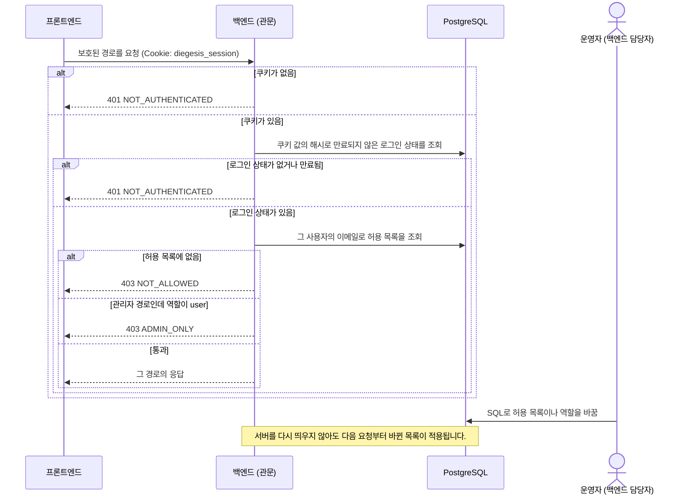

# API

이 문서는 프론트엔드와 백엔드가 주고받는 요청과 응답의 약속을 정의합니다. 왜 이런 방식을 골랐는지는 [ADR-005](ADR.md#adr-005-프론트엔드와의-api-연동-방식)와 [ADR-006](ADR.md#adr-006-로그인과-접근-제한)에, 로그인과 허용 목록의 세부는 [ADR-024](ADR.md#adr-024-허용-목록의-관리와-확인)와 [ADR-025](ADR.md#adr-025-google-로그인-흐름의-세부)에, 요청들이 어떤 순서로 오가는지는 [ARCHITECTURE.md](ARCHITECTURE.md#3-책을-읽는-동안의-흐름)에, 낯선 용어의 뜻은 [GLOSSARY.md](GLOSSARY.md)에 있습니다.

이 문서의 엔드포인트는 구현 전에 작성한 초안입니다. 서버가 구현된 뒤에는 서버가 자동으로 만들어 내는 OpenAPI 문서(`/api/openapi.json`)가 세부 형식의 기준이 되며, 이 문서는 전체 흐름과 규칙을 설명하는 역할을 맡습니다.

## 1. 프론트엔드가 남겨 둔 합의 항목에 대한 답

프론트엔드 레포의 `docs/architecture.md`에는 백엔드와 합의해야 할 항목 다섯 가지가 남아 있습니다. 각 항목에 대한 백엔드의 답은 다음과 같습니다.

| 프론트엔드의 질문 | 백엔드의 답 |
| --- | --- |
| API 기본 경로와 로컬 포트 | 모든 경로에 `/api` 접두사를 붙이고, 로컬 개발 서버는 `8080` 포트를 씁니다. 프론트엔드의 현재 설정과 같으므로 고칠 것이 없습니다. |
| 인증 방식 | 쿠키 방식을 씁니다. 백엔드가 Google 로그인을 처리한 다음, 스크립트가 읽을 수 없는 쿠키를 브라우저에 심습니다. 프론트엔드는 지금처럼 `credentials: 'include'`로 요청하면 됩니다. |
| 에러 응답 형식 | `{ "code", "message", "detail" }` 형식을 씁니다. 자세한 내용은 아래 2.3절에 있습니다. |
| API 스펙 공유 방식 | 서버가 `/api/openapi.json`으로 OpenAPI 문서를 제공합니다. 프론트엔드는 이 문서에서 TypeScript 타입을 자동으로 생성할 수 있으며, 같은 내용을 브라우저에서 `/api/docs`로 볼 수 있습니다. |
| 헬스체크 엔드포인트 | `GET /api/health`이며, `{ "status": "ok" }`를 응답합니다. |

## 2. 공통 규칙

### 2.1 요청과 응답의 형식

- 요청과 응답의 본문은 JSON이며, 필드 이름은 `snake_case`로 씁니다.
- 시각은 UTC 기준의 ISO 8601 문자열로 표현합니다. 예를 들면 `"2026-12-01T12:05:00Z"`와 같습니다.
- 길이와 위치는 밀리초 단위의 정수로 표현하며, 필드 이름 끝에 `_ms`를 붙입니다.
- 번호에는 필드 이름 끝에 `_no`를, 인덱스에는 `_idx`를 붙입니다. 예를 들어 `chapter_no`는 1부터 세고, `first_sentence_idx`는 0부터 셉니다. 다만 목록의 항목이 자기 자신의 인덱스를 담을 때에는 `idx`라고만 씁니다. 번호와 인덱스의 뜻은 [GLOSSARY.md](GLOSSARY.md#표기와-관련된-용어)에, 이렇게 정한 이유는 [ADR-017](ADR.md#adr-017-번호와-인덱스의-구분)에 있습니다.

### 2.2 로그인 상태

로그인에 성공하면 백엔드가 쿠키를 심고, 그 뒤의 모든 요청은 쿠키로 사용자를 식별합니다. 그래서 프론트엔드는 토큰을 저장하거나 요청 헤더에 붙일 필요가 없습니다.

쿠키 방식이 안정적으로 동작하려면 배포 환경에서 프론트엔드와 백엔드가 같은 도메인 아래에 있어야 합니다. 이 조건에 대한 설명은 [INFRA.md](INFRA.md)에 있습니다.

3절의 표에서 권한이 "로그인한 사용자"나 "관리자"인 경로를 보호된 경로라고 부릅니다. 보호된 경로의 요청은 매번 아래 순서로 관문을 거칩니다. 백엔드는 허용 목록을 기억해 두지 않고 요청마다 데이터베이스에서 확인하므로, 허용 목록에서 빠진 사람은 이미 로그인한 상태여도 다음 요청부터 막힙니다([ADR-024](ADR.md#adr-024-허용-목록의-관리와-확인)).



관문이 거절할 때의 응답과 프론트엔드가 할 일은 다음과 같습니다. 응답의 본문은 2.3절의 형식을 따릅니다.

| 응답 | 언제 받는가 | 프론트엔드가 할 일 |
| --- | --- | --- |
| `401 NOT_AUTHENTICATED` | 쿠키가 없거나, 백엔드가 모르는 값이거나, 로그인 상태가 만료됐을 때 | 로그인 화면(`/login`)으로 보냅니다. |
| `403 NOT_ALLOWED` | 로그인 상태는 있지만 그 이메일이 허용 목록에 없을 때. 로그인한 뒤에 허용 목록에서 빠진 경우입니다. | 허용 목록 밖 안내 화면(`/login?error=NOT_ALLOWED`)으로 보냅니다. |
| `403 ADMIN_ONLY` | 역할이 `user`인 사람이 관리자 경로를 호출했을 때 | 관리자 화면을 보여 주지 않습니다. 역할은 `GET /api/me`(4.3절)로 미리 알 수 있습니다. |

허용 목록은 관리 API 없이 데이터베이스에 SQL로 넣고 빼며, 그 SQL은 [README](../README.md#허용-목록에-사람-넣고-빼기)에 있습니다.

### 2.3 에러 응답

요청이 실패하면 백엔드는 알맞은 HTTP 상태 코드와 함께 아래 형식의 본문을 응답합니다.

| 필드 | 설명 |
| --- | --- |
| `code` | 프로그램이 분기하는 데 쓰는 식별자입니다. 대문자와 밑줄로 씁니다. |
| `message` | 사람이 읽을 수 있는 설명입니다. 화면에 그대로 보여 주어도 됩니다. |
| `detail` | 추가 정보가 있을 때에만 들어갑니다. 예를 들어 어느 필드가 잘못됐는지를 담습니다. |

```json
{
  "code": "VALIDATION_ERROR",
  "message": "요청 형식이 올바르지 않습니다.",
  "detail": [{ "field": "first_sentence_idx", "reason": "0 이상의 정수여야 합니다." }]
}
```

검증 오류(`VALIDATION_ERROR`)의 `detail`은 `{ "field", "reason" }`의 목록이며, 두 값은 언제나 문자열입니다. `field`는 잘못된 필드의 이름이고, 안쪽의 필드는 점으로 잇습니다. 예를 들어 `item.price`와 같으며, 목록 안의 항목은 `extras.0.price`처럼 그 항목의 인덱스를 넣습니다. 본문이 JSON으로 읽히지 않거나 본문 전체의 모양이 틀려서 특정 필드를 가리킬 수 없으면 `field`는 빈 문자열 `""`입니다.

```json
{
  "code": "VALIDATION_ERROR",
  "message": "요청 형식이 올바르지 않습니다.",
  "detail": [{ "field": "", "reason": "JSON decode error" }]
}
```

자주 쓰이는 에러 코드는 다음과 같습니다.

| HTTP 상태 | `code` | 언제 발생하는가 |
| --- | --- | --- |
| 400 | `VALIDATION_ERROR` | 요청의 형식이나 값이 잘못됐을 때 |
| 401 | `NOT_AUTHENTICATED` | 로그인하지 않았거나 로그인 상태가 만료됐을 때 (2.2절) |
| 403 | `NOT_ALLOWED` | 허용 목록에 없는 계정일 때 (2.2절) |
| 403 | `ADMIN_ONLY` | 관리자만 쓸 수 있는 경로를 일반 사용자가 호출했을 때 (2.2절) |
| 404 | `NOT_FOUND` | 요청한 책, 챕터, 선곡 기록 등이 없을 때 |
| 405 | `METHOD_NOT_ALLOWED` | 경로는 있지만 그 메서드로는 호출할 수 없을 때 |
| 422 | `BUNDLE_INVALID` | 올린 산출물 묶음이 규격에 어긋날 때 (4.9절) |
| 500 | `INTERNAL_ERROR` | 서버 내부에서 예상하지 못한 문제가 생겼을 때 |

위 표에 없는 상태 코드로 응답할 때에는 그 HTTP 상태의 영문 이름을 대문자와 밑줄로 쓴 값을 `code`로 씁니다. 예를 들어 409이면 `CONFLICT`입니다.

## 3. 엔드포인트 목록

| 메서드와 경로 | 용도 | 권한 |
| --- | --- | --- |
| [`GET /api/health`](#41-헬스체크) | 서버가 살아 있는지 확인합니다. | 누구나 |
| [`GET /api/auth/google/login`](#42-로그인과-로그아웃) | Google 로그인 화면으로 이동시킵니다. | 누구나 |
| [`GET /api/auth/google/callback`](#42-로그인과-로그아웃) | Google이 로그인 결과를 돌려주는 주소입니다. | Google만 호출 |
| [`POST /api/auth/logout`](#42-로그인과-로그아웃) | 로그아웃합니다. | 누구나 |
| [`GET /api/me`](#43-내-정보) | 내 정보를 조회합니다. | 로그인한 사용자 |
| [`GET /api/me/settings`](#44-선곡-설정) | 내 선곡 설정(임베딩 모델)과 고를 수 있는 모델의 목록을 조회합니다. | 로그인한 사용자 |
| [`PUT /api/me/settings`](#44-선곡-설정) | 내 선곡 설정(임베딩 모델)을 바꿉니다. | 로그인한 사용자 |
| [`GET /api/books`](#45-책-목록과-책-정보) | 책 목록을 조회합니다. | 로그인한 사용자 |
| [`GET /api/books/{book_id}`](#45-책-목록과-책-정보) | 책 한 권의 정보와 챕터 목록을 조회합니다. | 로그인한 사용자 |
| [`GET /api/books/{book_id}/chapters/{chapter_no}`](#46-챕터-본문) | 챕터의 본문을 조회합니다. | 로그인한 사용자 |
| [`POST /api/books/{book_id}/position`](#47-위치-알림) | 화면에 보이는 문장의 범위를 알리고, 곡을 어떻게 할지 응답받습니다. | 로그인한 사용자 |
| [`POST /api/recommendations/{id}/events`](#48-반응-기록) | 재생, 좋아요, 싫어요 같은 반응을 기록합니다. | 로그인한 사용자 |
| [`POST /api/admin/bundles`](#49-관리자-산출물-묶음-적재) | 산출물 묶음을 올립니다. | 관리자 |
| [`GET /api/admin/exports/recommendations`](#410-관리자-평가-자료-내보내기) | 선곡 기록을 CSV로 내려받습니다. | 관리자 |
| [`GET /api/admin/exports/playback-events`](#410-관리자-평가-자료-내보내기) | 반응 기록을 CSV로 내려받습니다. | 관리자 |

권한이 "관리자"인 경로는 프론트엔드의 관리자 화면이 호출합니다. 관리자 화면도 다른 화면과 같은 쿠키로 로그인 상태를 보내며, 백엔드는 허용 목록에서 역할이 `admin`인 사람의 요청만 처리합니다. 허용 목록을 조회하거나 바꾸는 API는 없습니다([ADR-024](ADR.md#adr-024-허용-목록의-관리와-확인)).

## 4. 엔드포인트별 형식과 예시

이 절은 모든 엔드포인트를 같은 틀로 적습니다. 엔드포인트 하나가 가장 바깥의 항목이고, 그 아래에 **Request Header**, **Request Body**, **Response Body**를 들여 써서 차례로 적습니다. 응답에 눈여겨볼 헤더가 있는 엔드포인트에는 **Response Header**를, 덧붙일 설명이 있는 엔드포인트에는 **설명**을 추가로 적습니다. 그리고 백엔드가 요청을 받아서 응답하기까지의 순서를 시퀀스 다이어그램으로 그린 **동작 순서**를 적습니다. 동작 순서는 그 엔드포인트를 만드는 Epic의 계약을 정할 때 더합니다. 동작 순서는 이 문서에만 그리며, Epic 문서는 이 그림을 가리키기만 합니다([DECISIONS.md](DECISIONS.md)의 D-56).

예시를 읽을 때에는 다음 세 가지를 알아 두면 됩니다.

- `Cookie` 헤더의 `diegesis_session`은 로그인 상태를 담은 쿠키이며, 예시에 적힌 값은 형태를 보여 주기 위한 것입니다. 이 헤더는 프론트엔드가 `credentials: 'include'`로 요청하면 브라우저가 자동으로 붙이므로, 프론트엔드 코드가 직접 다루지 않습니다.
- `Content-Type: application/json` 헤더는 요청에 JSON 본문이 있을 때에만 붙입니다.
- 요청이 실패했을 때의 응답은 모든 엔드포인트가 2.3절의 형식을 따르므로, 이 절에서는 성공했을 때의 응답만 적습니다.

### 4.1 헬스체크

- **`GET /api/health`**: 서버가 살아 있는지 확인합니다.
  - **Request Header**: 필요한 헤더가 없습니다. 로그인하지 않아도 호출할 수 있습니다.
  - **Request Body**: 없습니다.
  - **Response Body** (`200 OK`)

    ```json
    { "status": "ok" }
    ```

### 4.2 로그인과 로그아웃

로그인은 화면 이동으로 이루어지며, 프론트엔드가 JSON을 주고받지 않습니다. 순서는 다음과 같습니다.

1. 프론트엔드가 브라우저를 `/api/auth/google/login`으로 이동시킵니다.
2. 백엔드가 브라우저를 Google 로그인 화면으로 보냅니다. 이때 Google에 요청하는 정보는 이름, 이메일, 프로필(`openid`, `email`, `profile`)뿐입니다.
3. 사용자가 로그인하면 Google이 브라우저를 `{FRONTEND_URL}/api/auth/google/callback`으로 돌려보냅니다. 이 주소는 프론트엔드의 주소이며, 프론트엔드의 개발 서버나 호스팅이 `/api` 요청을 백엔드로 넘겨줍니다. `FRONTEND_URL`은 백엔드의 설정값입니다([CONFIGURATION.md 3.1절](CONFIGURATION.md#31-서버)).
4. 백엔드는 로그인 결과를 확인하고, 브라우저를 아래 표의 프론트엔드 주소 가운데 하나로 보냅니다. 쿠키는 로그인에 성공했을 때에만 심습니다.

| 프론트엔드의 주소 | 언제 보내지는가 | 프론트엔드가 보여 줄 것 |
| --- | --- | --- |
| `/` | 허용 목록에 있는 계정으로 로그인했을 때 | 첫 화면 |
| `/login?error=NOT_ALLOWED` | Google 로그인은 됐지만 그 이메일이 허용 목록에 없을 때 | 테스트 참가자만 쓸 수 있다는 안내 |
| `/login?error=LOGIN_FAILED` | 로그인이 끝나지 못했을 때. 사용자가 Google 동의 화면에서 취소했거나, 로그인을 시작한 브라우저와 결과를 받은 브라우저가 다르거나, Google이 이메일을 확인하지 않은 계정이거나, Google과 통신하다 실패한 경우입니다. | 다시 로그인해 달라는 안내 |

로그인 뒤에 돌아가는 곳은 언제나 첫 화면입니다. 실패의 자세한 원인은 주소에 담지 않고 백엔드의 로그에만 남깁니다([ADR-025](ADR.md#adr-025-google-로그인-흐름의-세부)).

각 엔드포인트의 형식은 다음과 같습니다.

- **`GET /api/auth/google/login`**: 브라우저를 Google 로그인 화면으로 이동시킵니다.
  - **Request Header**: 필요한 헤더가 없습니다. 프론트엔드는 이 주소를 `fetch`로 호출하지 않고, 브라우저의 주소를 이 주소로 바꿉니다.
  - **Request Body**: 없습니다.
  - **Response Header** (`302 Found`): 로그인을 시작한 브라우저를 확인하는 값(`state`)을 쿠키에 담아 두고 Google로 보냅니다.

    ```http
    Location: https://accounts.google.com/o/oauth2/v2/auth?client_id=...&redirect_uri=http%3A%2F%2Flocalhost%3A5173%2Fapi%2Fauth%2Fgoogle%2Fcallback&response_type=code&scope=openid%20email%20profile&state=Zx81kQ...
    Set-Cookie: diegesis_oauth_state=Zx81kQ...; HttpOnly; SameSite=Lax; Path=/api/auth/google; Max-Age=600
    ```

  - **Response Body**: 없습니다.
  - **동작 순서**

    ```mermaid
    sequenceDiagram
      actor U as 사용자
      participant B as 브라우저 (프론트엔드)
      participant BE as 백엔드
      participant G as Google

      U->>B: 로그인 버튼을 누른다
      B->>BE: GET /api/auth/google/login (화면 이동)
      BE->>BE: 임의의 state 값을 만든다
      BE-->>B: 302 Location: Google 로그인 화면<br/>Set-Cookie: diegesis_oauth_state
      B->>G: Google 로그인 화면을 연다
    ```

- **`GET /api/auth/google/callback`**: Google이 로그인 결과를 돌려주는 주소입니다. 프론트엔드가 직접 호출하지 않습니다.
  - **Request Header**: 로그인을 시작할 때 심은 `diegesis_oauth_state` 쿠키를 브라우저가 붙입니다. 로그인 결과는 Google이 주소 뒤에 붙여 주는 `code`와 `state` 쿼리로 전달됩니다.

    ```http
    GET /api/auth/google/callback?code=4/0AeaYSH...&state=Zx81kQ...
    Cookie: diegesis_oauth_state=Zx81kQ...
    ```

    사용자가 Google 동의 화면에서 취소하면 `code` 대신 `error` 쿼리가 옵니다.

    ```http
    GET /api/auth/google/callback?error=access_denied&state=Zx81kQ...
    ```

  - **Request Body**: 없습니다.
  - **Response Header** (`302 Found`): 어느 경우든 `diegesis_oauth_state` 쿠키를 지웁니다. 허용 목록에 있는 계정이라면 로그인 상태의 쿠키를 심고 프론트엔드의 첫 화면으로 보냅니다.

    ```http
    Location: http://localhost:5173/
    Set-Cookie: diegesis_session=4mXq8ZpT1vK0; HttpOnly; SameSite=Lax; Path=/; Max-Age=1209600
    Set-Cookie: diegesis_oauth_state=; Max-Age=0; Path=/api/auth/google
    ```

    허용 목록에 없는 계정이라면 로그인 상태의 쿠키를 심지 않고 아래 주소로 보냅니다. 로그인이 실패했을 때에는 `error=LOGIN_FAILED`로 보냅니다.

    ```http
    Location: http://localhost:5173/login?error=NOT_ALLOWED
    Set-Cookie: diegesis_oauth_state=; Max-Age=0; Path=/api/auth/google
    ```

  - **Response Body**: 없습니다.
  - **설명**
    - `Max-Age`는 로그인 상태가 유지되는 시간이며, 설정값 `LOGIN_SESSION_TTL_HOURS`로 정합니다([CONFIGURATION.md 3.3절](CONFIGURATION.md#33-로그인)). 위 예시는 기본값인 14일입니다.
    - 운영 환경(`APP_ENV`가 `production`)에서는 두 쿠키에 `Secure`가 더 붙습니다. 로컬은 HTTP이므로 붙이지 않습니다.
  - **동작 순서**

    ```mermaid
    sequenceDiagram
      participant B as 브라우저 (프론트엔드)
      participant BE as 백엔드
      participant G as Google
      participant DB as PostgreSQL

      G-->>B: 302 Location: {FRONTEND_URL}/api/auth/google/callback
      B->>BE: GET /api/auth/google/callback?code&state<br/>(Cookie: diegesis_oauth_state)
      alt error 쿼리가 있음, 또는 state 쿠키가 없거나 쿼리의 state와 다름
        BE-->>B: 302 /login?error=LOGIN_FAILED
      else state가 맞음
        BE->>G: code를 토큰으로 교환 (클라이언트 비밀값 포함)
        G-->>BE: ID 토큰 (이메일, email_verified, 이름)
        alt 교환이나 토큰 확인에 실패, 또는 email_verified가 false
          BE-->>B: 302 /login?error=LOGIN_FAILED
        else 이메일이 확인됨
          BE->>DB: 소문자로 바꾼 이메일로 허용 목록을 조회
          alt 허용 목록에 없음
            BE-->>B: 302 /login?error=NOT_ALLOWED (users에 등록하지 않음)
          else 허용 목록에 있음
            BE->>DB: users에 등록하거나 이름을 갱신
            BE->>BE: 임의의 쿠키 값을 만든다
            BE->>DB: login_sessions에 쿠키 값의 해시와 만료 시각을 저장
            BE-->>B: 302 / (Set-Cookie: diegesis_session)
          end
        end
      end
      Note over B,BE: 모든 응답에서 diegesis_oauth_state 쿠키를 지웁니다.
    ```

- **`POST /api/auth/logout`**: 로그아웃합니다.
  - **Request Header**

    ```http
    Cookie: diegesis_session=4mXq8ZpT1vK0
    ```

  - **Request Body**: 없습니다.
  - **Response Header** (`204 No Content`): 브라우저에 남아 있는 쿠키를 지웁니다.

    ```http
    Set-Cookie: diegesis_session=; Max-Age=0; Path=/
    ```

  - **Response Body**: 없습니다.
  - **설명**: 이 경로는 관문(2.2절)을 거치지 않습니다. 쿠키가 없거나 이미 무효인 상태로 호출해도, 허용 목록에서 빠진 사람이 호출해도 `204`를 응답합니다. 그래서 프론트엔드는 로그인 상태를 확인하지 않고 로그아웃을 호출해도 됩니다.
  - **동작 순서**

    ```mermaid
    sequenceDiagram
      participant FE as 프론트엔드
      participant BE as 백엔드
      participant DB as PostgreSQL

      FE->>BE: POST /api/auth/logout (Cookie: diegesis_session)
      opt 쿠키가 있음
        BE->>DB: 쿠키 값의 해시로 login_sessions의 행을 지움 (없으면 그대로 둠)
      end
      BE-->>FE: 204 (diegesis_session 쿠키를 지우는 Set-Cookie)
    ```

### 4.3 내 정보

- **`GET /api/me`**: 로그인한 사용자 자신의 정보를 조회합니다.
  - **Request Header**

    ```http
    Cookie: diegesis_session=4mXq8ZpT1vK0
    ```

  - **Request Body**: 없습니다.
  - **Response Body** (`200 OK`)

    ```json
    {
      "id": "0b9f6c1e-2c8a-4f5e-9a51-3d0c7b1e2f44",
      "email": "reader@example.com",
      "display_name": "독자",
      "role": "user"
    }
    ```

  - **설명**
    - `role`은 `user` 또는 `admin`이며, 허용 목록에 적힌 역할입니다. SQL로 역할을 바꾸면 다음 요청부터 바뀐 값이 나옵니다.
    - `display_name`은 Google 계정의 이름이며, 로그인할 때마다 갱신합니다.
    - 프론트엔드는 이 경로로 로그인했는지(`401`이면 로그인 전)와 관리자 화면을 보여 줄지(`role`)를 판단할 수 있습니다.
  - **동작 순서**

    ```mermaid
    sequenceDiagram
      participant FE as 프론트엔드
      participant BE as 백엔드
      participant DB as PostgreSQL

      FE->>BE: GET /api/me (Cookie: diegesis_session)
      Note over BE,DB: 2.2절의 관문을 거칩니다. 통과하지 못하면 401이나 403을 응답합니다.
      BE->>DB: 로그인 상태의 사용자와 허용 목록의 역할을 조회
      BE-->>FE: 200 (id, email, display_name, role)
    ```

### 4.4 선곡 설정

- **`GET /api/me/settings`**: 내 선곡 설정을 조회합니다.
  - **Request Header**

    ```http
    Cookie: diegesis_session=4mXq8ZpT1vK0
    ```

  - **Request Body**: 없습니다.
  - **Response Body** (`200 OK`)

    ```json
    {
      "embedding_model": "muq-mulan",
      "available_embedding_models": ["muq-mulan", "laion-clap-music"]
    }
    ```

  - **설명**
    - `embedding_model`은 선곡에 쓰는 임베딩 모델의 이름입니다. 사용자가 설정을 바꾸기 전에는 기본값이 들어 있습니다.
    - `available_embedding_models`는 고를 수 있는 임베딩 모델의 이름 목록이며, 백엔드에 등록된 모델이 모두 들어 있습니다. 모델은 산출물 묶음을 적재할 때 등록되므로, 이 목록은 묶음을 올릴 때마다 늘어날 수 있습니다.
    - 선곡 방식은 장면에 맞춘 선곡 한 가지뿐이므로, 사용자가 바꿀 수 있는 것은 임베딩 모델뿐입니다([ADR-021](ADR.md#adr-021-선곡-방식의-추상화를-없애고-설정에는-임베딩-모델만-둔다)).

- **`PUT /api/me/settings`**: 내 선곡 설정을 바꿉니다.
  - **Request Header**

    ```http
    Cookie: diegesis_session=4mXq8ZpT1vK0
    Content-Type: application/json
    ```

  - **Request Body**

    ```json
    { "embedding_model": "laion-clap-music" }
    ```

  - **Response Body** (`200 OK`): 바뀐 뒤의 설정을 조회할 때와 같은 형식으로 응답합니다.

    ```json
    {
      "embedding_model": "laion-clap-music",
      "available_embedding_models": ["muq-mulan", "laion-clap-music"]
    }
    ```

  - **설명**: `embedding_model`이 등록되지 않은 모델의 이름이면 `400 VALIDATION_ERROR`를 응답합니다.

### 4.5 책 목록과 책 정보

- **`GET /api/books`**: 책 목록을 조회합니다.
  - **Request Header**

    ```http
    Cookie: diegesis_session=4mXq8ZpT1vK0
    ```

  - **Request Body**: 없습니다.
  - **Response Body** (`200 OK`)

    ```json
    {
      "books": [
        {
          "id": "sample-novel",
          "title": "견본 소설",
          "author": "견본 작가",
          "language": "ko",
          "chapter_count": 3
        }
      ]
    }
    ```

- **`GET /api/books/{book_id}`**: 책 한 권의 정보와 챕터 목록을 조회합니다.
  - **Request Header**

    ```http
    Cookie: diegesis_session=4mXq8ZpT1vK0
    ```

  - **Request Body**: 없습니다.
  - **Response Body** (`200 OK`)

    ```json
    {
      "id": "sample-novel",
      "title": "견본 소설",
      "author": "견본 작가",
      "language": "ko",
      "chapters": [
        { "chapter_no": 1, "title": "제1장", "first_sentence_idx": 0, "last_sentence_idx": 511 },
        { "chapter_no": 2, "title": "제2장", "first_sentence_idx": 512, "last_sentence_idx": 1040 }
      ],
      "last_position": { "chapter_no": 1, "first_sentence_idx": 412 }
    }
    ```

  - **설명**: `last_position`은 사용자가 이 책을 마지막으로 읽은 위치입니다. 처음 읽는 책이라면 `null`입니다.

### 4.6 챕터 본문

- **`GET /api/books/{book_id}/chapters/{chapter_no}`**: 챕터의 본문을 조회합니다.
  - **Request Header**

    ```http
    Cookie: diegesis_session=4mXq8ZpT1vK0
    ```

  - **Request Body**: 없습니다.
  - **Response Body** (`200 OK`)

    ```json
    {
      "book_id": "sample-novel",
      "chapter_no": 1,
      "title": "제1장",
      "paragraphs": [
        {
          "paragraph_idx": 0,
          "sentences": [
            { "idx": 0, "text": "기차가 역을 빠져나가자 창밖으로 낮은 지붕들이 천천히 흘러갔다." },
            { "idx": 1, "text": "나는 이마를 유리창에 기댄 채 한동안 아무 생각도 하지 않았다." }
          ]
        },
        {
          "paragraph_idx": 1,
          "sentences": [
            { "idx": 2, "text": "옆자리의 라디오에서 오래된 노래가 작게 흘러나오기 시작했다." }
          ]
        }
      ]
    }
    ```

  - **설명**
    - 본문은 문단의 목록이고, 각 문단은 문장의 목록입니다. 문단의 `paragraph_idx`는 챕터 안에서 0부터 세고, 문장마다 붙은 `idx`는 문장 인덱스입니다.
    - 프론트엔드는 이 구조를 바탕으로 직접 페이지를 나누며, 한 페이지에 보이는 첫 문장과 마지막 문장의 `idx`를 기억해 두었다가 4.7절의 위치 알림 요청에 씁니다.
    - 장면의 경계는 이 응답에 들어 있지 않습니다. 어느 장면의 곡을 틀지는 백엔드가 판단하기 때문입니다.

### 4.7 위치 알림

- **`POST /api/books/{book_id}/position`**: 화면에 보이는 문장의 범위를 알리고, 곡을 어떻게 할지 응답받습니다. 책을 처음 열었을 때와 화면에 보이는 범위가 바뀔 때마다 호출합니다.
  - **Request Header**

    ```http
    Cookie: diegesis_session=4mXq8ZpT1vK0
    Content-Type: application/json
    ```

  - **Request Body**

    ```json
    {
      "chapter_no": 1,
      "first_sentence_idx": 412,
      "last_sentence_idx": 431,
      "current_recommendation_id": "8a2f4b1c-3d5e-4f6a-9b7c-0d1e2f3a4b5c"
    }
    ```

    | 요청 필드 | 설명 |
    | --- | --- |
    | `chapter_no` | 지금 보고 있는 챕터의 번호입니다. |
    | `first_sentence_idx` | 화면에 보이는 첫 문장의 문장 인덱스입니다. |
    | `last_sentence_idx` | 화면에 보이는 마지막 문장의 문장 인덱스입니다. |
    | `current_recommendation_id` | 지금 재생 중인 후보의 `recommendation_id`입니다. 재생 중인 곡이 없다면 `null`을 보냅니다. 구간이 끝나서 멈췄거나, 후보를 모두 싫어요로 넘겨서 틀 곡이 없는 경우도 여기에 해당합니다. |

  - **Response Body** (`200 OK`): 응답의 `action`은 아래 두 가지 가운데 하나이며, 프론트엔드는 이 값에 따라 동작합니다.

    | `action` | 뜻 | 프론트엔드가 할 일 |
    | --- | --- | --- |
    | `play` | 이 장면의 후보 목록입니다. | 지금 재생 중인 곡을 멈추고, 아래의 재생 규칙에 따라 후보 가운데 하나를 재생합니다. |
    | `keep` | 지금 재생 중인 곡이 이 장면의 곡입니다. | 지금 재생 중인 곡을 그대로 둡니다. |

    새 후보 목록을 받을 때(`play`)의 응답은 다음과 같습니다.

    ```json
    {
      "action": "play",
      "candidates": [
        {
          "recommendation_id": "c41e7a90-6b2d-4f0a-b1c3-9e8d7f6a5b40",
          "selection_reason": "embedding",
          "track": {
            "id": "trk_0042",
            "title": "Quiet Streets",
            "artist": "Example Artist",
            "audio_url": "https://storage.example.com/audio/trk_0042.mp3?expires=1796126700&signature=3f9a1c",
            "audio_url_expires_at": "2026-12-01T13:00:00Z",
            "duration_ms": 184000,
            "segment": { "start_ms": 30000, "end_ms": 60000 },
            "license": "CC0 1.0",
            "attribution": null,
            "liked": false
          }
        },
        {
          "recommendation_id": "7b2d9e41-0c5a-4d8f-a6b3-2e1f0d9c8b7a",
          "selection_reason": "embedding",
          "track": {
            "id": "trk_0107",
            "title": "Grey Afternoon",
            "artist": "Another Artist",
            "audio_url": "https://storage.example.com/audio/trk_0107.mp3?expires=1796126700&signature=8c2e4d",
            "audio_url_expires_at": "2026-12-01T13:00:00Z",
            "duration_ms": 212000,
            "segment": { "start_ms": 90000, "end_ms": 120000 },
            "license": "CC BY 4.0",
            "attribution": "Grey Afternoon by Another Artist, CC BY 4.0",
            "liked": true
          }
        }
      ]
    }
    ```

    장면이 그대로일 때(`keep`)의 응답은 다음과 같습니다.

    ```json
    { "action": "keep" }
    ```

  - **프론트엔드의 재생 규칙**: 후보 가운데 무엇을 틀지는 프론트엔드가 아래 규칙으로 정합니다([ADR-020](ADR.md#adr-020-위치-알림은-후보-k개를-돌려주고-프론트엔드가-재생할-곡을-고른다)).
    1. `selection_reason`이 `designated`인 후보가 있으면 그 후보를 먼저 재생합니다. 그런 후보가 없으면 후보 가운데 하나를 무작위로 골라 재생합니다.
    2. 재생은 구간이 시작하는 위치(`segment.start_ms`)에서 시작하고, 구간이 끝나는 위치(`segment.end_ms`)에서 멈춥니다. 구간이 끝났다고 해서 다음 후보를 이어서 틀지 않습니다.
    3. 사용자가 싫어요를 누르면 그 후보의 반응 기록으로 `disliked`를 보내고(4.8절), 아직 틀지 않은 후보 가운데 하나를 무작위로 골라 재생합니다.
    4. 후보를 모두 싫어요로 넘겼다면, 다음 위치 알림을 보낼 때까지 곡을 틀지 않습니다.
    5. `candidates`가 빈 목록이면 4번과 같이 다룹니다.

  - **설명**
    - 요청의 `first_sentence_idx`와 `last_sentence_idx`는 `chapter_no` 챕터의 범위, 곧 4.5절 응답에 있는 그 챕터의 `first_sentence_idx`부터 `last_sentence_idx`까지의 안에 있어야 합니다. 그리고 요청의 `first_sentence_idx`는 `last_sentence_idx`보다 클 수 없습니다. 이를 어기면 `400 VALIDATION_ERROR`를 응답합니다.
    - 후보는 최대 k개이며, k는 설정값입니다([CONFIGURATION.md](CONFIGURATION.md#34-선곡)). 장면이 직접 언급 장면이고 지정 곡이 있으면 그 곡을 `selection_reason`이 `designated`인 후보로 맨 앞에 두고, 나머지는 장면과 가까운 순서로 둡니다. 그 사용자가 싫어요를 누른 적이 있는 구간은 후보에 들어 있지 않습니다. 남은 구간이 없으면 `candidates`는 빈 목록입니다.
    - `segment`는 그 후보의 구간 위치입니다. 프론트엔드는 곡의 맨 앞이 아니라 이 구간이 시작하는 위치(`start_ms`)부터 재생합니다.
    - 백엔드는 `current_recommendation_id`로 지금 재생 중인 곡이 어느 장면의 후보인지를 찾습니다. 그 장면이 이번에 보이는 범위에서 고른 장면과 같다면 `keep`을 응답합니다. 반면에 `current_recommendation_id`가 `null`이면 장면이 같더라도 새 후보 목록을 `play`로 응답합니다. 그래서 구간이 끝나서 멈췄거나 후보를 모두 넘겼다면, 다음 페이지에서 다시 곡이 나옵니다.
    - 후보의 `recommendation_id`는 다음 위치 알림의 `current_recommendation_id`와 4.8절의 반응 기록에 씁니다.
    - `liked`는 사용자가 그 곡에 좋아요를 누른 상태인지를 나타냅니다.
    - `audio_url`은 서명된 주소입니다. 서명된 주소는 정해진 시간 동안만 유효한 임시 주소이며, 음원 파일은 이 주소로만 받을 수 있습니다. 그러므로 프론트엔드는 다음 세 가지를 지켜야 합니다.
      - `audio_url`을 저장해 두었다가 나중에 다시 쓰지 않습니다. 이 주소는 `audio_url_expires_at`에 적힌 시각이 지나면 쓸 수 없게 됩니다.
      - 주소를 고치거나 조립하지 않고 받은 그대로 씁니다. 주소의 일부를 바꾸면 서명이 맞지 않아서 요청이 거부됩니다. 위 예시의 `expires`와 `signature`는 형태를 보여 주기 위한 것이며, 실제 모양은 저장소 서비스에 따라 다릅니다.
      - 사용자가 곡을 오래 일시정지해 두었다가 다시 재생하는 경우처럼 주소가 만료된 뒤에 음원을 다시 받아야 한다면, `current_recommendation_id`를 `null`로 두고 위치 알림을 다시 보내서 새 후보 목록을 받습니다.

### 4.8 반응 기록

- **`POST /api/recommendations/{id}/events`**: 재생, 좋아요, 싫어요 같은 반응을 기록합니다. 경로의 `id`는 반응이 가리키는 후보의 `recommendation_id`입니다.
  - **Request Header**

    ```http
    Cookie: diegesis_session=4mXq8ZpT1vK0
    Content-Type: application/json
    ```

  - **Request Body**

    ```json
    { "type": "disliked", "position_ms": 42000 }
    ```

    | 요청 필드 | 설명 |
    | --- | --- |
    | `type` | 반응의 종류입니다. 아래 표의 다섯 가지 가운데 하나를 보냅니다. |
    | `position_ms` | 그 순간 곡의 재생 위치입니다. |

    | `type` | 언제 보내는가 |
    | --- | --- |
    | `started` | 후보의 구간이 실제로 재생되기 시작했을 때 보냅니다. 여러 후보 가운데 실제로 재생된 것은 이 이벤트로 알 수 있습니다. |
    | `completed` | 구간이 끝나는 위치까지 재생됐을 때 보냅니다. |
    | `liked` | 사용자가 좋아요를 눌렀을 때 보냅니다. |
    | `unliked` | 사용자가 좋아요를 취소했을 때 보냅니다. |
    | `disliked` | 사용자가 싫어요를 눌렀을 때 보냅니다. 이 후보의 구간은 그 사용자에게 다시 나오지 않습니다. 프론트엔드는 음악을 멈추지 않고 다른 후보를 틉니다(4.7절의 재생 규칙). |

  - **Response Body**: `204 No Content`이며 본문이 없습니다.
  - **설명**: 일시정지와 다시 재생은 반응으로 보지 않으므로 보내지 않습니다. 좋아요는 곡 단위로, 싫어요는 구간 단위로 적용합니다. 그래서 좋아요를 누른 곡은 다른 구간이 후보로 나와도 `liked`가 `true`이고, 싫어요를 누른 구간과 같은 곡의 다른 구간은 다시 후보로 나올 수 있습니다.

### 4.9 관리자: 산출물 묶음 적재

- **`POST /api/admin/bundles`**: 산출물 묶음을 올립니다.
  - **Request Header**

    ```http
    Cookie: diegesis_session=4mXq8ZpT1vK0
    Content-Type: multipart/form-data; boundary=----bundle-boundary
    ```

  - **Request Body**: zip 파일 하나를 `file` 필드에 담습니다.

    ```http
    ------bundle-boundary
    Content-Disposition: form-data; name="file"; filename="sample-novel.zip"
    Content-Type: application/zip

    (zip 파일의 내용)
    ------bundle-boundary--
    ```

  - **Response Body** (`200 OK`): 적재가 끝난 뒤에 응답합니다.

    ```json
    { "bundle_type": "book" }
    ```

  - **Response Body** (`422 Unprocessable Entity`): 묶음이 규격에 어긋나면 아무것도 적재하지 않고 오류 목록을 응답합니다.

    ```json
    {
      "code": "BUNDLE_INVALID",
      "message": "묶음이 규격에 맞지 않습니다.",
      "detail": [
        { "file": "scenes.jsonl", "line_no": 7, "reason": "end_sentence_idx(455)가 마지막 문장 인덱스(440)보다 큽니다." },
        { "file": "scenes.jsonl", "line_no": 9, "reason": "gems에 쓸 수 없는 값(fear)이 있습니다." },
        { "file": "scene_embeddings.muq-mulan.parquet", "reason": "벡터의 차원이 512가 아닙니다." }
      ]
    }
    ```

  - **설명**: 에러의 형식은 2.3절과 같고, `detail`이 `{ "file", "line_no", "reason" }`의 목록입니다. 묶음의 규격과 검증 항목은 [AI_CONTRACT.md](AI_CONTRACT.md)에 정의되어 있습니다. 백엔드는 검증과 적재를 모두 마친 뒤에 응답하므로, 적재의 결과를 따로 조회하는 엔드포인트는 없습니다([ADR-019](ADR.md#adr-019-정확-검색과-동기-적재)). 오류의 `line_no`는 그 파일에서 문제가 있는 줄의 번호이며 1부터 셉니다. Parquet 파일처럼 줄을 가리킬 수 없는 파일의 오류에는 `line_no`가 없습니다.

### 4.10 관리자: 평가 자료 내보내기

두 엔드포인트는 모두 CSV 파일을 응답하며, `from`과 `to` 쿼리로 기간을 지정할 수 있습니다. 앱 밖에서 받는 설문과는 사용자의 이메일로 연결하므로, 설문에서도 같은 Google 이메일을 받아야 합니다.

- **`GET /api/admin/exports/recommendations`**: 선곡 기록을 CSV로 내려받습니다.
  - **Request Header**

    ```http
    GET /api/admin/exports/recommendations?from=2026-12-01&to=2026-12-08
    Cookie: diegesis_session=4mXq8ZpT1vK0
    ```

  - **Request Body**: 없습니다.
  - **Response Header** (`200 OK`)

    ```http
    Content-Type: text/csv; charset=utf-8
    Content-Disposition: attachment; filename="recommendations.csv"
    ```

  - **Response Body**

    ```csv
    recommendation_id,candidate_list_id,rank_idx,created_at,user_email,book_id,book_version,scene_id,selection_reason,embedding_model,track_id,segment_id,segment_start_ms,similarity,scene_valence,scene_arousal,scene_tags,scene_gems,segment_valence,segment_arousal,segment_tags,segment_gems
    c41e7a90-...,5d3f1a2b-...,0,2026-12-01T12:01:10Z,reader@example.com,sample-novel,1,scene_0007,embedding,muq-mulan,trk_0042,trk_0042_s00,0,0.412,-0.6,-0.35,sad|melancholic,sadness,-0.55,-0.4,sad|melancholic,sadness|nostalgia
    ```

  - **설명**: 한 줄이 후보 하나입니다. 위치 알림 응답 하나에 담긴 후보들은 같은 `candidate_list_id`를 가지며, `rank_idx`는 그 목록 안에서의 순서입니다(0부터 셉니다). 후보 가운데 실제로 재생된 것은 반응 기록 CSV의 `started`를 `recommendation_id`로 이어서 알 수 있습니다. 뒤의 여덟 열은 그 장면과 후보 구간의 평가 라벨입니다([AI_CONTRACT.md 2절](AI_CONTRACT.md#라벨에-대한-규칙)). `tags`와 `gems`처럼 값이 여러 개인 열은 한 칸 안에서 `|`로 잇습니다. 이 열들로 장면과 구간의 V-A 거리, 태그와 GEMS 차원의 일치 여부를 계산할 수 있습니다.

- **`GET /api/admin/exports/playback-events`**: 반응 기록을 CSV로 내려받습니다.
  - **Request Header**

    ```http
    GET /api/admin/exports/playback-events?from=2026-12-01&to=2026-12-08
    Cookie: diegesis_session=4mXq8ZpT1vK0
    ```

  - **Request Body**: 없습니다.
  - **Response Header** (`200 OK`)

    ```http
    Content-Type: text/csv; charset=utf-8
    Content-Disposition: attachment; filename="playback-events.csv"
    ```

  - **Response Body**

    ```csv
    event_id,created_at,recommendation_id,user_email,type,position_ms
    9a8b7c6d-...,2026-12-01T12:01:52Z,c41e7a90-...,reader@example.com,disliked,42000
    ```

## 5. 프론트엔드와 더 합의할 것

- 독자가 페이지를 빠르게 연달아 넘길 때 위치 알림 요청을 얼마나 묶어서 보낼지 정해야 합니다.
