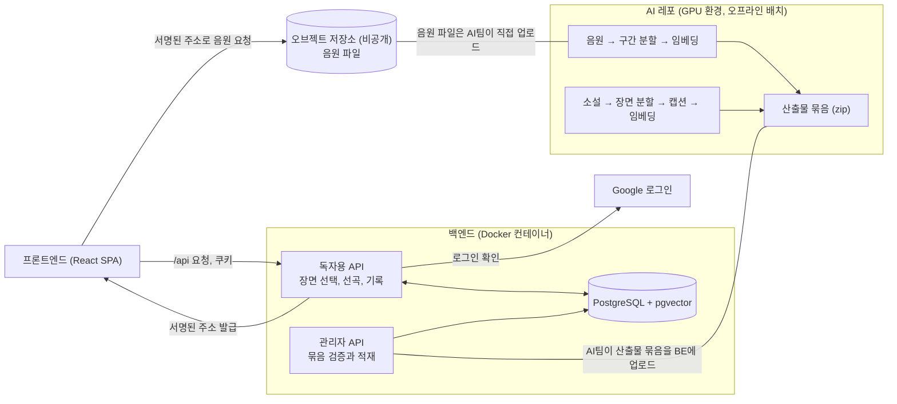
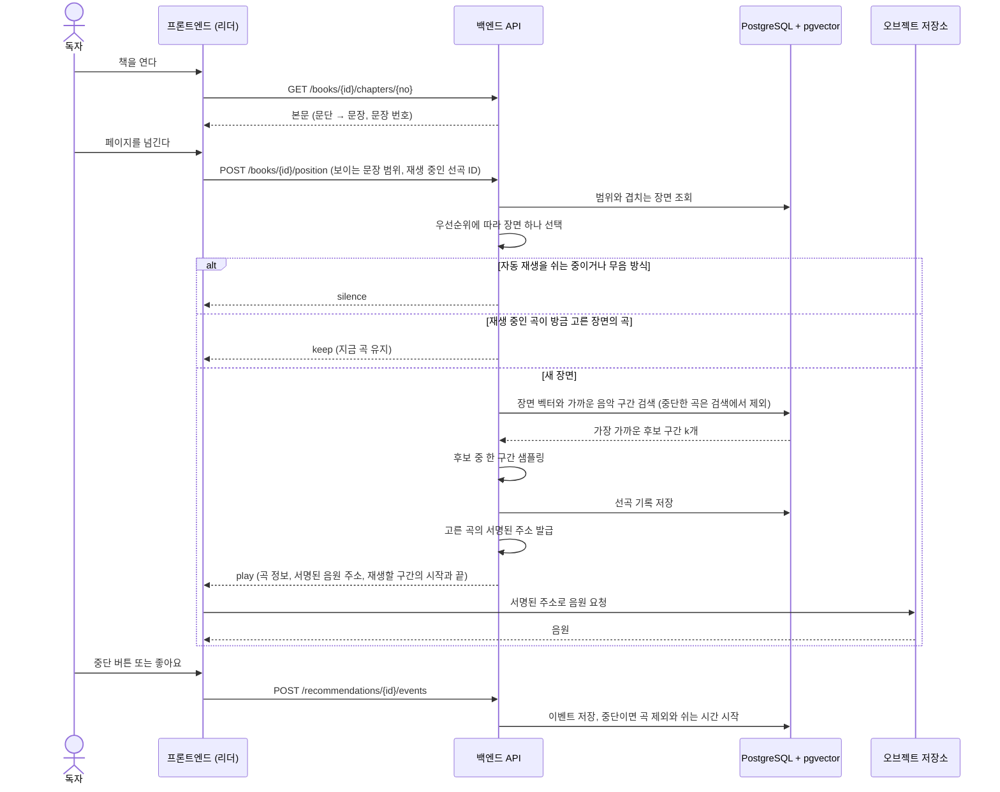
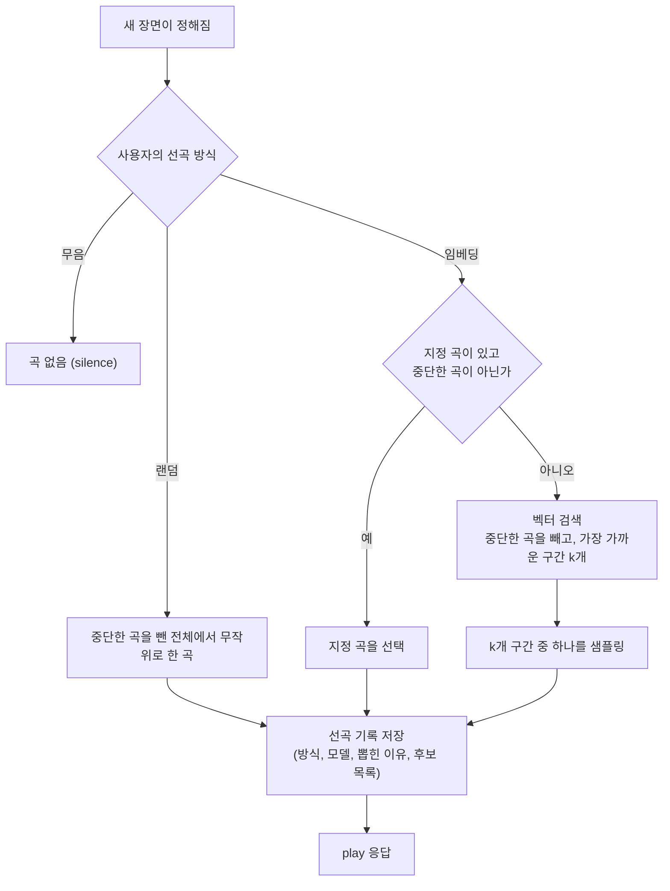
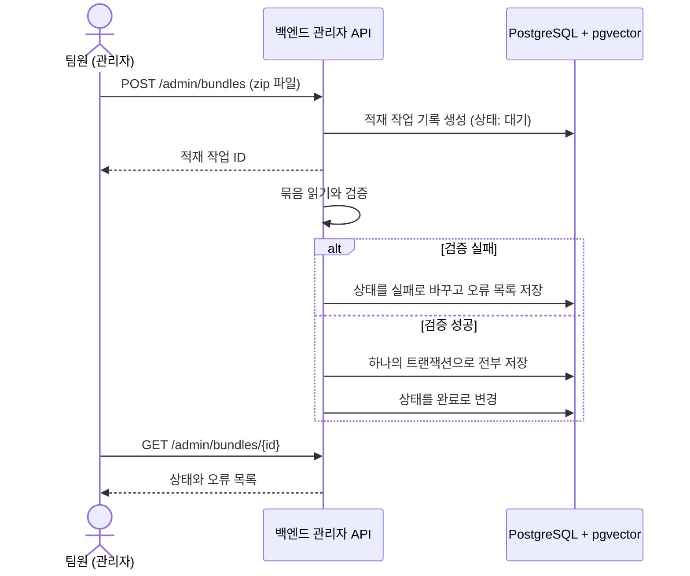
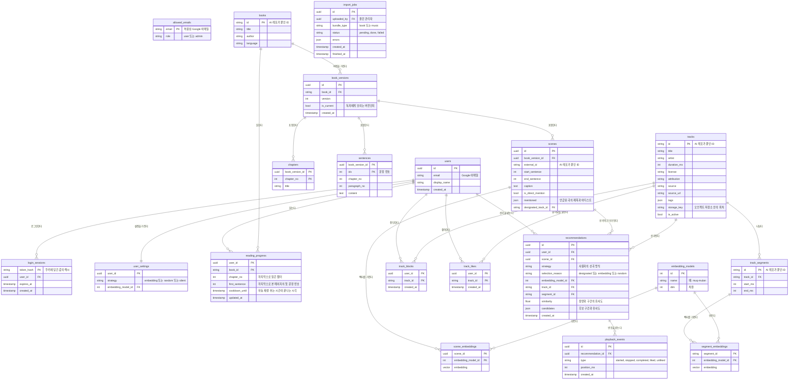
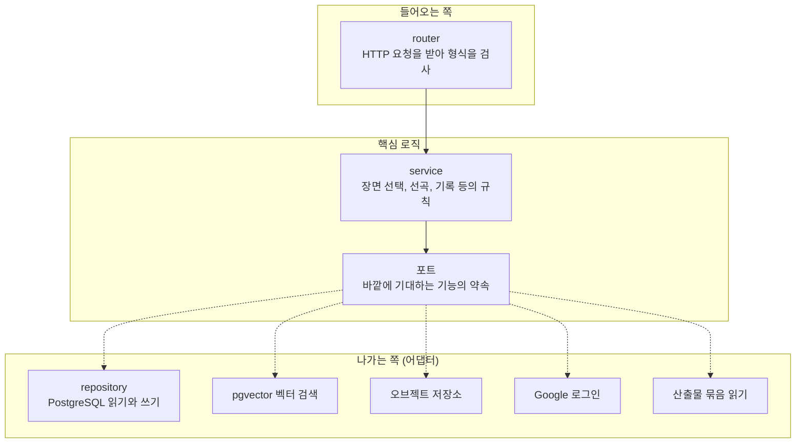

# 아키텍처

이 문서는 1차 마일스톤(MVP)의 백엔드 구조를 그림으로 보여 주고, 그림마다 설명을 덧붙입니다. 각 선택을 왜 했는지는 [ADR.md](ADR.md)에, 낯선 용어의 뜻은 [GLOSSARY.md](GLOSSARY.md)에 따로 정리되어 있으므로 이 문서에서는 반복하지 않습니다.

## 1. 설계의 목표

백엔드는 다음 세 가지를 해내야 합니다.

1. 허용된 사용자가 Google 계정으로 들어와 책을 읽으면, 페이지를 넘길 때 그 장면에 어울리는 곡을 골라 줍니다.
2. 어떤 장면에 어떤 곡이 어떤 방식으로 나갔는지, 그리고 사용자가 어떻게 반응했는지를 빠짐없이 기록합니다. MVP의 목적이 평가 자료를 모으는 것이기 때문입니다.
3. AI팀이 백엔드 코드를 고치지 않고도 새 책, 새 음원, 새 임베딩 모델을 추가할 수 있게 합니다.

반대로 다음 일은 MVP에서 하지 않습니다. 

1. 서버에서 AI 모델을 실행하지 않고, 
2. 일반 사용자의 책 업로드를 받지 않으며, 
3. 앱 안에서 설문을 받지 않습니다.

또한 다음 두 가지 결점이 있으면 모든 기능이 동작하더라도 실패로 간주합니다. 

1. 저작권이 있는 본문이 허용 목록 밖의 사람에게 보이는 것.
2. 평가에 쓸 기록이 빠지거나 선곡 방식이 기록에 남지 않는 것.

## 2. 전체 구성



그림은 왼쪽부터 프론트엔드, 가운데에 백엔드와 오브젝트 저장소, 오른쪽에 AI 레포와 Google 로그인의 순서로 놓았습니다. 화살표의 머리는 요청이나 파일이 **향하는 쪽**을 가리킵니다. 다만 AI 레포와 이어진 두 선은 이 배치를 유지하기 위해 화살표 머리 없이 그렸으며, 파일이 움직이는 방향은 선에 붙은 설명에 적었습니다.

이 그림에서 가장 중요한 점은 **백엔드가 AI 모델을 실행하지 않는다**는 것입니다. 장면을 나누고, 캡션을 쓰고, 임베딩을 만드는 일은 모두 AI 레포가 GPU가 있는 환경에서 미리 해 둡니다. 그리고 그 결과를 **산출물 묶음**이라는 파일로 내놓으면, 팀원이 관리자 API로 올리고 백엔드는 내용을 검사한 뒤 데이터베이스에 넣습니다. 따라서 AI 레포와 백엔드 사이의 약속은 **산출물 묶음의 파일 규격** 하나뿐이며, 그 규격은 [AI_CONTRACT.md](AI_CONTRACT.md)에 정의되어 있습니다.

한편 사용자가 책을 읽는 동안에는 **백엔드**가 데이터베이스 안에서 **벡터 검색만 수행**합니다. 장면의 벡터와 음악 구간의 벡터가 같은 임베딩 모델로 만들어져 있어서, 둘을 바로 비교할 수 있기 때문입니다. 그래서 일반 데이터와 벡터를 PostgreSQL 한곳에 함께 저장하며, 벡터를 다루는 기능은 **pgvector**라는 PostgreSQL 확장 기능이 제공합니다.

음원 파일은 용량이 크므로 데이터베이스가 아니라 **오브젝트 저장소**에 둡니다. 이때 오브젝트 저장소는 비공개로 두며, **음원 파일은 백엔드가 발급한 서명된 주소로만 받을 수 있습니다.** 서명된 주소(presigned URL)는 정해진 시간 동안만 유효한 임시 주소입니다. 백엔드는 로그인한 사용자에게 곡을 골라 줄 때마다 그 곡의 서명된 주소를 새로 발급해서 응답에 담고, **브라우저는 그 주소로 저장소에서 음원을 직접 받아 재생**합니다. 따라서 음원 파일 자체는 백엔드를 거치지 않지만, 로그인하지 않은 사람이나 주소가 만료된 사람은 음원을 받을 수 없습니다. 이 규칙은 음원의 라이선스와 관계없이 항상 적용합니다.

## 3. 책을 읽는 동안의 흐름



위 그림의 각 단계를 순서대로 설명하면 다음과 같습니다. 요청과 응답의 정확한 형식은 [API.md](API.md)에 있습니다.

1. **본문을 받습니다.** 독자가 책을 열면 프론트엔드는 챕터의 본문을 문단과 문장으로 나뉜 형태로 받습니다. 그리고 문장마다 책 전체에서 통하는 문장 번호가 붙어 있습니다.
2. **보이는 범위를 알립니다.** 페이지를 나누는 일은 화면 크기와 글꼴을 아는 프론트엔드가 맡습니다. 그래서 페이지가 바뀔 때마다 프론트엔드는 지금 화면에 보이는 첫 문장 번호와 마지막 문장 번호를 백엔드에 보냅니다. 이때 지금 재생 중인 곡이 있다면, 그 곡을 받을 때 함께 받았던 **선곡 ID**도 같이 보냅니다.
3. **장면을 하나 고릅니다.** 백엔드는 그 범위와 겹치는 장면들을 찾습니다. 만약 한 페이지에 장면이 여러 개 걸쳐 있다면 아래의 우선순위로 하나를 고릅니다.
   1. 음악이 직접 언급된 장면을 가장 먼저 고릅니다.
   2. 그런 장면이 없다면 페이지에서 가장 많은 문장을 차지하는 장면을 고릅니다.
   3. 분량이 같다면 먼저 나오는 장면을 고릅니다.
4. **곡을 바꿀지 판단합니다.** 먼저 그 사용자가 그 책에서 자동 재생을 쉬는 중이거나 사용자의 선곡 방식이 무음이라면, 백엔드는 `silence`를 응답합니다. 그렇지 않다면 프론트엔드가 보낸 선곡 ID로 선곡 기록을 찾아서, 지금 재생 중인 곡이 **어느 장면 때문에 고른 곡인지**를 확인합니다. 그 장면이 방금 고른 장면과 같다면 장면이 바뀌지 않은 것이므로, 백엔드는 곡을 새로 고르지 않고 지금 곡을 유지하라는 뜻으로 `keep`을 응답합니다. 이 비교가 없으면 장면 하나가 여러 페이지에 걸쳐 있을 때 페이지를 넘길 때마다 곡이 바뀌게 됩니다. 그리고 판단에 필요한 정보가 요청과 선곡 기록에 모두 들어 있으므로, 백엔드는 "직전에 어떤 장면의 곡을 틀었는지"를 따로 기억해 두지 않습니다.
5. **곡을 고릅니다.** 새 장면이라면 사용자가 설정한 선곡 방식에 따라 곡을 고릅니다. 자세한 방법은 바로 아래 4절에서 설명합니다.
6. **기록하고 응답합니다.** 백엔드는 선곡 기록을 저장한 다음, 곡의 제목과 아티스트, 서명된 음원 주소와 그 만료 시각, 장면과 맞아떨어진 구간의 시작과 끝, 라이선스 표기를 응답합니다. 그리고 프론트엔드는 곡의 맨 앞이 아니라 **그 구간이 시작하는 위치부터** 재생합니다. 음악을 구간으로 나누어 임베딩하므로, 장면과 맞는다고 판단한 대상이 곡 전체가 아니라 그 구간이기 때문입니다.
7. **반응을 기록합니다.** 프론트엔드는 재생이 시작됐을 때, 사용자가 중단했을 때, 곡이 끝까지 재생됐을 때, 좋아요를 눌렀을 때 각각 이벤트를 보냅니다. 특히 중단 이벤트를 받으면 백엔드는 그 곡을 해당 사용자에게 다시 틀지 않도록 제외 목록에 넣고, 자동 재생 쉬는 시간을 시작합니다. 쉬는 시간은 사용자와 책의 쌍마다 따로 적용되므로, 한 책에서 곡을 중단하더라도 다른 책에는 영향을 주지 않습니다.
8. **곡이 끝났는데 장면이 그대로라면** 프론트엔드는 "곡이 끝났다"는 표시와 함께 2단계의 요청을 다시 보냅니다. 이 경우에는 장면이 같더라도 백엔드가 `keep`을 응답하지 않고, 같은 장면에 대해 곡을 새로 골라 줍니다.

## 4. 곡을 고르는 방법



선곡 방식은 세 가지이며, 사용자가 설정 화면에서 직접 바꿀 수 있습니다. 평가에서 "우리 선곡이 무작위 선곡이나 무음보다 나은가"를 비교하기 위해서입니다.

**임베딩 방식**은 우리 서비스의 본래 선곡 방식입니다. 먼저 장면의 벡터와 가장 가까운 음악 구간 k개를 데이터베이스에서 찾습니다. 이때 그 사용자가 중단한 적이 있는 곡의 구간은 **검색하는 쿼리 안에서 처음부터 빼기** 때문에, 돌려받는 k개에는 중단한 곡이 들어 있지 않습니다. 그리고 후보의 단위는 곡이 아니라 구간입니다. 그래서 한 곡에서 나온 여러 구간이 후보에 함께 들어갈 수 있으며, 이를 따로 걸러 내지 않습니다. 장면의 분위기와 맞는 구간이라면 어느 곡에서 나왔든 재생하는 것이 맞기 때문입니다. 그런 다음 k개 가운데 한 구간을 샘플링하고, 그 구간이 속한 곡을 그 구간이 시작하는 위치부터 재생합니다. 이렇게 하면 같은 장면을 다시 읽을 때마다 다른 곡이 나올 수 있습니다.

아래는 이 검색이 어떤 모양의 쿼리가 되는지를 보여 주는 개념 예시입니다. 실제 구현에서는 표현이 달라질 수 있습니다.

```sql
-- 개념 예시: 중단한 곡의 구간을 처음부터 빼고, 장면과 가장 가까운 구간 k개를 가져온다.
SELECT s.track_id, s.id AS segment_id,
       e.embedding <=> :scene_vector AS distance        -- <=> 는 코사인 거리
FROM segment_embeddings e
JOIN track_segments s ON s.id = e.segment_id
JOIN tracks t ON t.id = s.track_id
WHERE e.model_id = :model_id
  AND t.is_active
  AND NOT EXISTS (SELECT 1 FROM track_blocks b
                  WHERE b.user_id = :user_id AND b.track_id = t.id)
ORDER BY distance
LIMIT :k;
```

다만 한 가지 주의할 점이 있습니다. 벡터 검색을 빠르게 해 주는 근사 인덱스는 조건으로 걸러 낸 뒤에 k개보다 적은 결과를 돌려줄 수 있습니다. 따라서 구현할 때에는 pgvector의 반복 스캔 옵션을 쓰거나 인덱스 없이 정확하게 검색하는 방법으로 k개가 실제로 채워지는지를 테스트로 확인해야 합니다. 음악 목록이 수천 곡 규모라면 정확 검색으로도 충분히 빠를 것으로 예상합니다.

그리고 이전에 이미 나온 곡을 따로 빼지는 않습니다. 제외하는 곡은 사용자가 중단한 곡뿐입니다.

**지정 곡의 우선 처리**는 임베딩 방식에만 적용합니다. 직접 언급 장면에 지정 곡이 있으면 벡터 검색을 건너뛰고 그 곡을 고릅니다. 반면에 랜덤 방식과 무음 방식은 비교의 기준선이므로 지정 곡이 있더라도 원래 규칙대로 동작합니다. 그리고 선곡 기록에는 사용자의 선곡 방식과는 별도로 "이 곡이 뽑힌 이유"를 지정 곡, 임베딩, 랜덤 가운데 하나로 남깁니다.

k의 크기, 샘플링할 때 후보를 똑같은 확률로 뽑을지 가까운 곡에 더 높은 확률을 줄지, 자동 재생 쉬는 시간의 길이는 모두 설정값이며 [CONFIGURATION.md](CONFIGURATION.md)에서 바꿀 수 있습니다.

## 5. 산출물 묶음을 적재하는 흐름



적재는 묶음 단위로 전부 성공하거나 전부 실패합니다. 다시 말해 검증에서 하나라도 문제가 발견되면 데이터베이스에는 아무것도 들어가지 않으며, 무엇이 잘못됐는지가 오류 목록으로 남습니다.

적재 요청 후 받는 응답에는 성공 여부가 들어있지 않습니다. 팀원(관리자)는 적재 요청 후 GET API를 통해 적재 작업의 상태를 추적할 수 있습니다. 이는 추후 2차 마일스톤에서 AI모델을 호출해 분석하는 방식으로 바뀔 때 비동기 응답으로 바꾸는 수고를 덜기 위해서입니다. 

같은 책을 다시 올리면 기존 내용을 지우지 않고 **새 버전**으로 쌓습니다. 독자에게는 가장 최신 버전만 보이지만, 과거의 선곡 기록은 그 당시 버전의 장면을 계속 가리킵니다. 장면을 다시 나눈 묶음을 올리더라도 이전 평가 기록이 사라지거나 엉뚱한 장면을 가리키지 않게 하기 위해서입니다. 한편 음악 묶음은 AI 레포가 붙인 곡 ID를 기준으로 새 곡은 추가하고 기존 곡은 갱신합니다. 그리고 곡은 삭제하지 않고 비활성화만 하는데, 이는 그 곡에 달린 중단 기록과 좋아요 기록을 보존하기 위해서입니다.

또한 적재 과정을 "묶음을 읽고 검증하는 단계"와 "저장하는 단계"로 나누어 둡니다. 그러면 2차 마일스톤에서 원본 책을 올리면 서버가 AI 모델을 호출해 분석하는 방식으로 바꾸더라도, 저장하는 단계는 그대로 다시 쓸 수 있습니다.

## 6. 데이터 모델



이 그림은 초안이며, 컬럼의 세부 타입과 인덱스는 구현하면서 정합니다. `PK`가 여러 컬럼에 붙어 있는 테이블은 그 컬럼들의 조합이 한 줄을 가리킨다는 뜻입니다. 그림을 읽을 때 알아 두면 좋은 점은 다음과 같습니다.

- **사용자 영역**에서는 `allowed_emails`가 출입문 역할을 합니다. Google 로그인에 성공하더라도 이 목록에 이메일이 없으면 `users`에 등록되지 않습니다. 그리고 `role`이 `admin`인 사람만 관리자 API를 쓸 수 있습니다. 한편 `login_sessions`는 로그인 상태를 한 줄씩 담으며, 쿠키의 값을 그대로 저장하지 않고 해시로 바꿔서 저장합니다.
- **책 영역**에서는 책 한 권이 여러 버전을 가질 수 있고, 챕터와 문장과 장면은 특정 버전에 속합니다. 장면은 시작 문장 번호와 끝 문장 번호로 범위를 표현합니다.
- **음악 영역**에서는 곡이 여러 구간으로 나뉘고, 벡터는 구간마다 붙습니다. 곡과 구간의 ID는 AI 레포가 붙인 것을 그대로 씁니다.
- **임베딩 영역**에서는 장면의 벡터와 구간의 벡터가 각각 "어떤 모델이 만들었는지"를 함께 저장합니다. 이 구조 덕분에 같은 장면에 대해 MuQ-MuLan의 벡터와 LAION-CLAP의 벡터를 나란히 가질 수 있습니다.
- **읽기 상태**는 `reading_progress`가 사용자와 책의 쌍마다 한 줄씩 담습니다. 여기에는 마지막으로 읽은 위치와 자동 재생 쉬는 시간이 끝나는 시각이 들어갑니다.
- **기록 영역**에서는 `recommendations`가 평가의 중심입니다. 누구에게, 어느 장면 때문에, 어떤 선곡 방식과 모델로, 어떤 이유로 이 곡이 나갔는지와 그때의 후보 목록까지 남기므로, 나중에 "왜 이 곡이 나왔는지"를 되짚어 볼 수 있습니다. 또한 3절에서 설명한 `keep` 판단도 이 기록의 `scene_id`를 읽어서 합니다. 한편 `track_blocks`는 사용자가 중단한 곡을, `track_likes`는 사용자가 좋아요를 누른 곡을 담습니다.
- **적재 영역**의 `import_jobs`는 산출물 묶음을 올릴 때마다 한 줄씩 생기며, 적재의 상태와 오류 목록을 담습니다.

## 7. 임베딩 모델과 선곡 방식을 쉽게 추가하는 구조

백엔드는 임베딩 모델을 실행하지 않고 그 모델이 만든 벡터만 저장합니다. 그래서 백엔드에게 임베딩 모델은 코드가 아니라 **등록된 데이터 한 줄**입니다. 새 모델을 추가할 때에는 AI팀이 그 모델로 만든 벡터를 담은 산출물 묶음을 올리기만 하면 됩니다. 묶음의 `manifest.json`에 모델의 이름과 차원이 적혀 있으므로, 백엔드는 처음 보는 모델이라면 `embedding_models`에 자동으로 등록하고 그 모델 전용 검색 인덱스를 만듭니다. 따라서 백엔드 코드를 고칠 필요가 없습니다.

모델마다 차원이 다를 수 있으므로, 벡터를 담는 컬럼에는 차원을 고정하지 않습니다. 그 대신 모델이 등록될 때 "이 모델의 벡터만 대상으로 하는" 인덱스를 따로 만듭니다.

한편 선곡 방식은 코드로 구현해야 하므로, 모든 방식이 따르는 공통 인터페이스인 `RecommendationStrategy`를 둡니다. 임베딩, 랜덤, 무음이 각각 이 인터페이스의 구현체이며, 새 방식을 추가할 때에는 구현체를 하나 더 만들어 등록하면 됩니다. 예를 들어 리서치에서 제안된 "감정 점수(V-A)로 먼저 거른 뒤 임베딩으로 고르는 방식"도 같은 방법으로 추가할 수 있습니다.

사용자는 설정 화면에서 선곡 방식과 임베딩 모델을 직접 고르며, 고른 값은 `user_settings`에 저장됩니다.

## 8. 코드 구조



코드는 기능별로 폴더를 나누고, 각 기능 폴더 안에서는 `router`, `service`, `repository`의 순서로만 의존합니다. 그리고 핵심 로직이 바깥 세계와 닿는 지점은 모두 포트로 추상화합니다. 따라서 `service`는 PostgreSQL이나 Google 같은 특정 기술의 이름을 알지 못하며, 실제 구현체인 어댑터는 서버가 시작될 때 주입됩니다. 이 구조의 장점은 기술을 바꿀 때 어댑터만 새로 만들면 되고, 테스트할 때에는 가짜 어댑터를 끼워 넣을 수 있다는 것입니다.


| 포트                                     | MVP에서 쓰는 어댑터                     | 나중에 바꿀 수 있는 것          |
| -------------------------------------- | -------------------------------- | ---------------------- |
| `VectorSearch`                         | pgvector                         | Qdrant 같은 전용 벡터 데이터베이스 |
| `ObjectStorage` (음원 파일의 서명된 주소를 발급합니다) | 로컬 파일시스템, 그리고 인프라가 정해지면 클라우드 저장소 | S3, GCS, R2            |
| `IdentityProvider`                     | Google                           | 다른 소셜 로그인              |
| `BundleReader`                         | zip 묶음                           | AI 모델 서비스 호출 (2차 마일스톤) |
| `RecommendationStrategy`               | 임베딩, 랜덤, 무음                      | 감정 점수를 결합한 방식 등        |


폴더 구조는 다음과 같습니다.

```
BE/
├── app/
│   ├── main.py            # 서버 시작점. 라우터와 어댑터를 조립한다.
│   ├── __main__.py        # python -m app 으로 서버를 실행한다.
│   ├── core/              # 설정, DB 연결, 로그인 상태 확인, 에러 형식, 포트 정의
│   ├── health/            # 헬스체크
│   ├── auth/              # Google 로그인, 로그인 상태, 허용 목록
│   ├── books/             # 책, 챕터, 문장, 장면 조회, 읽은 위치
│   ├── music/             # 곡, 구간, 음원 주소
│   ├── recommendation/    # 장면 선택, 선곡 방식, 샘플링
│   ├── playback/          # 재생 이벤트, 좋아요, 중단한 곡 제외
│   ├── admin/             # 묶음 적재, 허용 목록 관리, 평가 자료 내보내기
│   └── adapters/          # 포트의 구현체 (pgvector, storage, google, bundle)
├── migrations/            # 데이터베이스 구조 변경 이력 (Alembic)
├── tests/                 # app/ 과 같은 구조로 둔다.
├── scripts/               # 로컬 개발용 예시 데이터 만들기 등
├── docs/
├── .github/workflows/     # 검사와 자동 배포 (CI/CD)
├── Dockerfile             # 서버의 컨테이너 이미지
├── compose.yaml           # 로컬에서 데이터베이스, 마이그레이션, 서버를 함께 띄운다.
├── alembic.ini            # Alembic 설정
├── .env.example
└── .gitignore
```

각 기능 폴더 안에는 다음 다섯 파일을 둡니다.


| 파일              | 역할                                  |
| --------------- | ----------------------------------- |
| `router.py`     | HTTP 경로를 정의하고, 요청을 `service`에 넘깁니다. |
| `service.py`    | 그 기능의 규칙을 담습니다. 포트에만 의존합니다.         |
| `repository.py` | 데이터베이스를 읽고 씁니다.                     |
| `models.py`     | 데이터베이스 테이블을 정의합니다.                  |
| `schemas.py`    | 요청과 응답의 형식을 정의합니다.                  |

다만 헬스체크(`health/`)처럼 규칙도 저장할 데이터도 없는 기능 폴더에는 `router.py`와 `schemas.py`만 둡니다.


## 9. 기술스택


| 영역                  | 선택                                    | 선택한 이유가 적힌 곳                                                   |
| ------------------- | ------------------------------------- | -------------------------------------------------------------- |
| 언어와 프레임워크           | Python, FastAPI, Pydantic             | [ADR-001](ADR.md#adr-001-언어와-프레임워크)                            |
| 데이터베이스와 벡터 검색       | PostgreSQL, pgvector                  | [ADR-002](ADR.md#adr-002-데이터베이스와-벡터-검색)                        |
| 데이터베이스 접근과 구조 변경 관리 | SQLAlchemy(비동기), Alembic              | [ADR-009](ADR.md#adr-009-데이터베이스-접근-도구와-개발-도구)                  |
| 통합 테스트용 데이터베이스      | testcontainers                        | [ADR-011](ADR.md#adr-011-통합-테스트용-데이터베이스)                    |
| 로그인                 | Google OAuth 2.0, 서버에 저장하는 로그인 상태와 쿠키 | [ADR-006](ADR.md#adr-006-로그인과-접근-제한)                           |
| 패키지 관리와 코드 품질       | uv, ruff, pyright, pytest, actionlint | [ADR-009](ADR.md#adr-009-데이터베이스-접근-도구와-개발-도구)                  |
| 배포                  | Docker 컨테이너                           | [ADR-010](ADR.md#adr-010-배포-방식), [INFRA.md](INFRA.md)          |
| 자동 배포와 이미지 보관       | GitHub Actions, Docker Hub            | [ADR-010](ADR.md#adr-010-배포-방식), [INFRA.md](INFRA.md#37-자동-배포) |


각 도구의 버전은 프로젝트를 세팅하는 시점에 최신 안정 버전을 확인해서 고정합니다.

## 10. 구현하면서 정할 것

다음 항목은 이 문서에서 정하지 않고 구현하는 사람에게 맡깁니다.

- 테이블 컬럼의 세부 타입과 인덱스
- 용량이 큰 묶음을 요청을 받은 자리에서 바로 적재할지, 뒤에서 따로 처리할지
- 샘플링 방식과 k의 기본값, 자동 재생 쉬는 시간의 기본값 (모두 설정값으로 조정할 수 있게 둡니다)