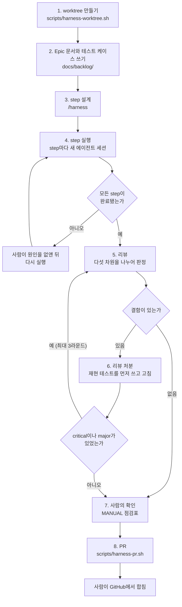

# 작업 절차 안내서

이 문서는 harness를 운영하는 사람이 따르는 절차를 설명합니다. harness는 OnlineFourCut 프로젝트에서 쓰던 것을 이 레포의 기술스택에 맞춰 옮긴 것입니다. 코드를 쓸 때 지키는 규칙은 [DEVELOPMENT.md](DEVELOPMENT.md)에 있고, 낯선 용어의 뜻은 [GLOSSARY.md](GLOSSARY.md)에 있습니다.

이 문서는 흐름과 순서만 맡습니다. 세부 규정은 그것을 실제로 쓰는 파일에 있으며, 어느 파일이 무엇을 맡는지는 [6절](#6-세부-규정이-있는-곳)에 모아 두었습니다.

## 1. 작업 하나가 거치는 단계



4번부터 6번까지는 `scripts/harness-run.sh` 하나가 사람 없이 이어서 실행합니다. 사람이 직접 하는 일은 1번부터 3번까지의 설계, 7번의 확인, 8번의 승인입니다.

각 단계에서 일어나는 일은 다음과 같습니다.

| 단계 | 하는 일 | 남는 것 |
| --- | --- | --- |
| 1. worktree | Orca로 `feat-<phase 이름>` 브랜치의 worktree를 만들고, 설계하던 대화도 그 worktree의 새 탭으로 옮깁니다. 이후의 모든 일은 이 worktree 안에서 합니다. | Orca 사이드패널의 항목 |
| 2. Epic 문서 | 이번 작업의 목표, Story, 테스트 케이스를 씁니다. | `docs/backlog/epic-N/` |
| 3. step 설계 | Epic을 서로 독립적으로 실행할 수 있는 step으로 나눕니다. step마다 실행할 수 있는 완료 조건과 반증 조건을 적습니다. | `phases/<phase 이름>/` |
| 4. step 실행 | step마다 새 에이전트 세션을 헤드리스로 띄워 구현하게 합니다. 실패하면 세 번까지 다시 시도하고, step이 끝날 때마다 커밋합니다. | step별 커밋 |
| 5. 리뷰 | 구현한 세션과 무관한 새 에이전트 세션이 correctness, security, architecture, test coverage, behavioral의 다섯 차원으로 판정합니다. 이 세션은 코드를 고치지 않습니다. | `review/review-N.md` |
| 6. 리뷰 처분 | 또 다른 새 에이전트 세션이 결함을 하나씩 대조해서, 고치거나 근거를 들어 기각하거나 사람에게 넘깁니다. | `review/fix-N.md`, 수정 커밋 |
| 7. 사람의 확인 | 사람만 볼 수 있는 항목을 직접 확인하고 체크합니다. 항목이 없는 phase도 있습니다. | 체크된 `MANUAL.md` |
| 8. PR | 관문을 점검하고 검사를 다시 돌립니다. 새 에이전트 세션이 지금의 코드를 읽고 이 phase가 만든 것을 요약하면, 그 요약과 리뷰·처분 기록으로 본문을 만듭니다. 사람이 본문을 확인한 뒤에 PR을 엽니다. | PR |

구현, 리뷰, 처분을 서로 다른 에이전트 세션에 맡기는 이유는 자기가 한 일을 자기가 판정하지 않게 하기 위해서입니다. 구현한 세션은 자기 코드를 옳다고 보는 쪽으로 기울고, 판정한 세션이 직접 고치면 "고쳤으니 없는 문제"가 됩니다.

## 2. 사람이 하는 순서

### 2.1 준비

처음 한 번만 확인합니다.

- [DEVELOPMENT.md 1절](DEVELOPMENT.md#1-개발-환경-준비)대로 `uv sync`를 실행했습니다.
- Orca 앱이 켜져 있고 `orca status`의 `runtimeReachable`이 `true`입니다.
- Docker Desktop이 켜져 있습니다. 검사 명령의 통합 테스트와 compose 스모크가 Docker를 쓰므로, 꺼져 있으면 무인 step이 모두 실패합니다.
- `claude` 명령이 로그인된 상태입니다.
- PR을 열 사람은 `gh auth status`가 통과합니다.

### 2.2 설계

1. 메인 체크아웃에서 Claude Code를 실행하고 `/harness`를 실행합니다. 에이전트와 함께 문서를 읽고, 이번 Epic에서 정할 것을 논의합니다.
2. 파일을 쓰기 전에 에이전트가 worktree를 만들고, 대화를 그 worktree로 옮깁니다.

   ```bash
   scripts/harness-worktree.sh 3-books --handoff
   ```

   이 명령은 worktree를 만든 뒤 그 worktree에 새 Orca 탭을 열고, 지금까지의 대화를 그 탭에서 이어받게 합니다. 그래서 대화와 그 worktree의 변경사항이 한 화면에 함께 보입니다. 새 탭이 뜨면 원래 탭은 닫습니다. 사람이 일반 터미널에서 worktree만 만들 때에는 `--handoff`를 빼고 실행하며, 출력의 마지막 줄이 worktree의 경로입니다.
3. 새 탭에서 Epic 문서와 테스트 케이스를 씁니다. 형식은 [backlog/README.md](backlog/README.md)에 있습니다. 대응하는 GitHub 이슈의 번호를 문서 머리에 적습니다.
4. step을 설계합니다. 에이전트가 초안을 내면 사람이 검토하고 고칩니다. step 파일은 무인 실행 전에 사람이 손댈 수 있는 마지막 자리이므로, 반증 조건과 금지사항을 여기서 확정합니다.
5. Epic 문서와 `phases/` 아래의 파일을 커밋합니다.

### 2.3 실행

worktree 안에서 실행합니다. 수십 분이 걸리므로 터미널을 따로 열어 두거나 백그라운드로 띄웁니다.

```bash
scripts/harness-run.sh 3-books
```

끝나면 종료 코드를 봅니다. 코드별로 할 일은 [`.claude/commands/harness.md`](../.claude/commands/harness.md)의 종료 코드표에 있습니다. 자주 만나는 경우는 셋입니다.

| 종료 코드 | 상황 | 할 일 |
| --- | --- | --- |
| 0 | 모두 끝났습니다. | 2.5로 갑니다. |
| 5 | 구현, 리뷰, 처분은 끝났고 사람의 확인이 남았습니다. | 2.4로 갑니다. |
| 6 | 리뷰와 처분이 닫히지 않았습니다. | `phases/<phase 이름>/review/`의 마지막 리포트와 처분 기록을 읽고 사람이 정합니다. |

### 2.4 사람의 확인

`phases/<phase 이름>/MANUAL.md`의 항목을 직접 확인하고, `- [ ]`를 `- [x]`로 바꾼 뒤 그 항목 아래의 `관찰한 값`에 본 것을 적습니다. 본 것이 여러 가지면 한 단계 더 들여 쓴 목록으로 나눕니다. 그리고 커밋한 뒤 같은 명령을 다시 실행합니다. 이미 끝난 step과 리뷰는 다시 돌지 않으며, phase가 완료로 기록됩니다.

처분 기록에 "사람 판단 필요"가 있으면 그 항목을 사람이 정합니다. 정한 뒤에는 그 항목을 처분 기록의 "고쳤다"나 "기각했다"로 옮기고, 파일 끝에 있는 `disposition` 줄의 숫자를 고칩니다.

### 2.5 PR

```bash
scripts/harness-pr.sh 3-books            # 점검하고 본문을 보여 주기만 합니다.
scripts/harness-pr.sh 3-books --create   # 브랜치를 올리고 PR을 엽니다. 열린 PR이 있으면 그 본문을 바꿉니다.
```

먼저 `--create` 없이 실행해서 본문을 확인합니다. 문제가 없으면 `--create`를 붙여 다시 실행합니다. 요약은 레포에 남기지 않고 본문에만 실으며, 코드가 그대로면 다시 쓰지 않으므로 확인한 본문이 그대로 나갑니다. PR을 연 뒤에 코드가 바뀌었으면 `--create`로 다시 실행해 본문을 맞춥니다. PR을 합치는 방식은 [DEVELOPMENT.md 6.3절](DEVELOPMENT.md#63-pr)에 있습니다.

PR이 합쳐진 뒤에는 Orca에서 그 worktree를 정리합니다.

## 3. 파일이 놓이는 곳

```
.claude/
  settings.json                 # 훅 배선
  commands/harness.md           # /harness: step 설계와 실행
  commands/review.md            # /review: phase-review 스킬을 부른다
  commands/review-fix.md        # /review-fix: review-fix 스킬을 부른다
  skills/phase-review/          # 리뷰의 절차, 차원별 브리프
  skills/review-fix/            # 리뷰 처분의 절차
scripts/
  check.sh                      # 검사 명령
  harness-worktree.sh           # worktree 만들기
  harness-run.sh                # step 실행, 리뷰, 처분
  execute.py                    # step을 순서대로 실행
  harness-pr.sh                 # PR 준비
  hooks/                        # 가드
docs/backlog/
  README.md                     # Epic 지도와 형식
  epic-3/E3-books.md            # Epic 문서
  epic-3/testcase.md            # 테스트 케이스
phases/
  index.json                    # 전체 phase의 상태
  3-books/
    index.json                  # step의 상태와 요약
    step0.md, step1.md, ...     # step 파일
    MANUAL.md                   # 사람이 확인하는 점검표 (있을 때만)
    review/review-1.md          # 리뷰 리포트
    review/fix-1.md             # 리뷰 처분 기록
```

Epic의 번호와 phase의 이름은 짝을 이룹니다. `docs/backlog/epic-3/`의 Epic은 `phases/3-books/`에서 실행하며, 브랜치는 `feat-3-books`입니다.

`phases/` 아래의 파일은 레포에 커밋합니다. 다만 에이전트 세션의 원본 출력인 `step*-output.json`과 `review/session.log`는 커밋하지 않습니다.

harness는 아래 형식으로 커밋을 만듭니다. 범위에는 phase의 이름이 들어갑니다.

| 만드는 때 | 메시지 | 예 |
| --- | --- | --- |
| step이 끝났을 때의 코드 | `feat(<phase>): step <번호> — <step 이름>` | `feat(3-books): step 1 — books-router` |
| step이 끝났을 때의 상태 기록 | `chore(<phase>): step <번호> output` | `chore(3-books): step 1 output` |
| 리뷰가 끝났을 때 | `docs(<phase>): <N>차 리뷰 리포트 — critical <a> · major <b> · minor <c>` | `docs(3-books): 1차 리뷰 리포트 — critical 0 · major 1 · minor 2` |
| 처분하는 동안 | `test(<phase>): RED — …`, `fix(<phase>): …`, `docs(<phase>): …` | `fix(3-books): 1차 리뷰 SEC-1 — 챕터 경로에 허용 목록 확인을 건다` |
| phase가 완료됐을 때 | `chore(<phase>): mark phase completed` | `chore(3-books): mark phase completed` |

## 4. 환경 변수와 의존

### 4.1 사람이 바꿀 수 있는 값

| 이름 | 뜻 | 기본값 |
| --- | --- | --- |
| `HARNESS_MODEL` | 헤드리스로 띄우는 에이전트 세션의 모델입니다. step 실행, 리뷰, 처분, PR 본문의 요약에 모두 적용됩니다. | `claude-opus-5-5` |
| `HARNESS_MAX_REVIEW_ROUNDS` | 리뷰와 처분을 되풀이하는 최대 횟수입니다. | `3` |

```bash
HARNESS_MODEL=claude-sonnet-5-5 scripts/harness-run.sh 3-books
```

### 4.2 harness가 스스로 넣는 값

아래 값은 harness가 에이전트 세션을 띄울 때 넣으며, 가드가 이 값을 보고 동작을 바꿉니다. 사람이 직접 넣지 않습니다.

| 이름 | 넣는 때 | 가드의 동작 |
| --- | --- | --- |
| `HARNESS_RUN` | step 실행과 리뷰 처분 | 가드와 검사 설정을 고치지 못하게 하고, 백그라운드 실행과 push를 막습니다. |
| `HARNESS_REVIEW` | 리뷰와 PR 본문의 요약 | 종료 검사를 건너뛰고, 백그라운드 실행과 push를 막습니다. |

### 4.3 필요한 도구

| 도구 | 쓰는 곳 |
| --- | --- |
| `claude` | 에이전트 세션을 띄웁니다. |
| `uv` | 검사 명령을 실행합니다. |
| `orca` | worktree를 만들고, 설계하던 대화를 그 worktree의 새 탭으로 옮깁니다. Orca가 만들지 않은 worktree는 사이드패널에 보이지 않으므로, `git worktree add`로 대신하지 않습니다. |
| `gh` | PR을 엽니다. |
| `docker` | 통합 테스트의 데이터베이스와 compose 스모크를 띄웁니다. |
| `jq` 또는 `python3` | 가드가 입력을 읽습니다. 둘 다 없으면 가드가 아무것도 막지 않습니다. |

리뷰는 다섯 차원을 하위 에이전트 다섯에게 나누어 맡기고 결과를 메시지로 돌려받습니다. 이 방식은 Claude Code의 에이전트 팀 기능에 기대며, 이 기능은 환경 변수 `CLAUDE_CODE_EXPERIMENTAL_AGENT_TEAMS=1`로 켭니다. 지금은 이 값을 레포의 설정에 넣지 않았으므로, harness를 돌릴 사람이 자기 Claude Code 설정에 넣어 두어야 합니다.

## 5. 알려진 한계

- **무인 실행은 권한 확인 없이 돕니다.** 헤드리스 에이전트 세션은 `--dangerously-skip-permissions`로 실행되므로, 사람에게 묻지 않고 명령을 실행합니다. 되돌릴 수 없는 명령을 막는 것은 명령 가드뿐입니다. 그래서 무인 실행은 비밀값이나 운영 환경의 자격 증명이 없는 환경에서 돌립니다.
- **종료 검사는 세 번까지만 되돌립니다.** 그 뒤에는 검사가 실패한 채로 에이전트 세션이 끝날 수 있고, 그 상태로 step이 완료로 기록될 수 있습니다. 이 경우는 리뷰의 실측이 잡아냅니다.
- **명령 가드는 명령의 글자를 봅니다.** 그래서 막아야 할 문구가 들어 있는 검색 명령이나 커밋 메시지도 함께 막습니다.
- **대화를 옮기는 일은 공식 문서에 없는 값에 기댑니다.** `scripts/harness-worktree.sh --handoff`는 Claude Code가 Bash 도구에 넣는 `CLAUDE_CODE_SESSION_ID`와 `CLAUDE_PID`로 대화와 실행 옵션을 찾습니다. 두 값은 Claude Code의 공식 문서에 없어서, Claude Code가 바뀌면 동작하지 않을 수 있습니다. 그리고 대화를 옮긴 뒤 원래 탭은 사람이 닫아야 합니다.
- **처분도 스스로 채점합니다.** 고친 에이전트 세션이 "고쳤다"와 "기각했다"를 스스로 적습니다. critical이나 major가 있던 라운드는 다음 리뷰가 그 기록을 다시 판정하지만, minor만 있던 라운드는 다시 리뷰하지 않습니다. PR을 검토할 때 처분 기록의 기각 항목을 함께 봐 주세요.

## 6. 세부 규정이 있는 곳

| 정보 | 맡은 파일 |
| --- | --- |
| step 설계의 원칙, `index.json`과 step 파일의 형식, MANUAL 점검표의 작성 기준, 종료 코드와 복구 방법 | [`.claude/commands/harness.md`](../.claude/commands/harness.md) |
| 리뷰의 절차, 심각도의 정의, 리포트의 형식 | [`.claude/skills/phase-review/SKILL.md`](../.claude/skills/phase-review/SKILL.md) |
| 리뷰의 차원별 점검 항목과 전례 | [`.claude/skills/phase-review/references/dimensions.md`](../.claude/skills/phase-review/references/dimensions.md) |
| 리뷰 처분의 절차, 무인 처분이 하지 않는 것, 처분 기록의 형식 | [`.claude/skills/review-fix/SKILL.md`](../.claude/skills/review-fix/SKILL.md) |
| Epic 문서와 테스트 케이스의 형식, Story를 step으로 옮기는 규칙 | [backlog/README.md](backlog/README.md) |
| 검사 명령, 테스트 규칙, 커밋과 브랜치와 PR의 규칙 | [DEVELOPMENT.md](DEVELOPMENT.md) |
| 가드의 정확한 규칙 | `scripts/hooks/`의 각 스크립트 |
| 이 절차를 정한 결정과 이유 | [DECISIONS.md](DECISIONS.md)의 D-26부터 D-35까지 |

`.claude/` 아래의 파일은 에이전트가 읽는 지시문이어서, 문서 작성 규칙의 문체를 따르지 않고 짧은 명령문으로 씁니다.
