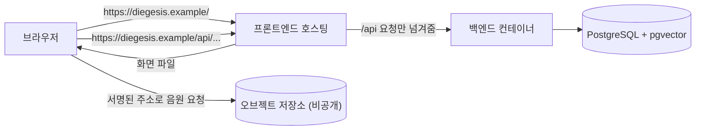
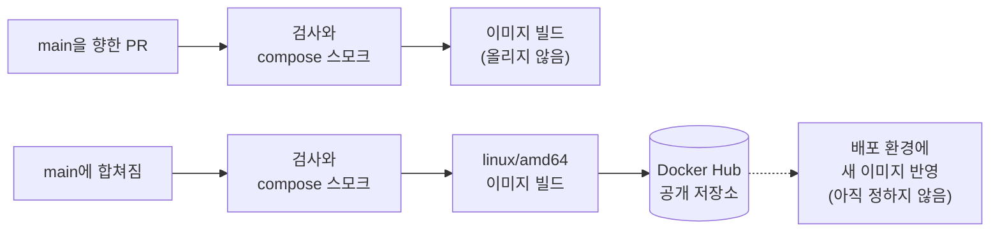

# 인프라

이 문서는 배포 환경에 관한 내용을 다룹니다. 현재 확정된 것은 "Docker 컨테이너로 배포한다"는 것과 "`main` 브랜치에 합쳐진 코드를 자동으로 배포한다"는 것이며([ADR-010](ADR.md#adr-010-배포-방식)), 나머지는 프론트엔드와 상의한 뒤에 정하기로 했습니다. 그래서 이 문서는 결론을 내리지 않고, 무엇을 정해야 하는지와 정할 때 무엇을 따져 보아야 하는지를 정리합니다. 인프라가 정해지면 이 문서에 선택한 구성과 배포 절차를 채워 넣습니다.

## 1. 지금까지 정해진 것

| 항목 | 내용 |
| --- | --- |
| 배포 단위 | 백엔드는 Docker 컨테이너 하나로 배포합니다. |
| 로컬 개발 환경 | Docker Compose로 API 서버와 PostgreSQL을 함께 띄웁니다. 띄우는 방법은 [README](../README.md)에 있습니다. |
| 로컬의 마이그레이션 | compose의 일회성 서비스 `migrate`가 실행하고, API 서버는 그 서비스가 성공한 뒤에 뜹니다([DECISIONS.md](DECISIONS.md)의 D-40). |
| 자동 배포 | 코드가 `main` 브랜치에 합쳐지면 자동으로 컨테이너 이미지를 만들어 배포합니다. 자세한 내용은 [3.7절](#37-자동-배포)에 있습니다. |
| 컨테이너 이미지의 보관 | 만든 이미지는 Docker Hub의 공개 저장소에 저장하며, `linux/amd64` 이미지만 올립니다([DECISIONS.md](DECISIONS.md)의 D-37). |
| 음원 파일의 접근 방식 | 오브젝트 저장소는 비공개로 두고, 백엔드가 발급한 서명된 주소로만 음원을 받을 수 있게 합니다. |
| 음원의 라이선스 | 현재는 퍼블릭 도메인이거나 저작권의 제약이 없는 음원만 씁니다. |
| 프로젝트의 성격 | 포트폴리오용이며 창업 계획은 없습니다. 따라서 비용을 거의 들이지 않는 것이 우선입니다. |
| 후보로 언급된 방식 | GCP 무료 계정을 옮겨 가며 쓰는 방식을 사용자가 후보로 꼽았습니다. |

## 2. 반드시 충족해야 하는 조건

어떤 인프라를 고르더라도 아래 조건은 지켜야 합니다. 이 조건들은 이미 내린 다른 결정에서 따라 나온 것입니다.

| 조건 | 이유 |
| --- | --- |
| 프론트엔드와 백엔드가 같은 도메인 아래에 있어야 합니다. | 로그인 상태를 쿠키로 주고받기 때문입니다([ADR-006](ADR.md#adr-006-로그인과-접근-제한)). 도메인이 서로 다르면 Safari 같은 브라우저가 쿠키를 막을 수 있습니다. |
| PostgreSQL에서 pgvector 확장 기능을 쓸 수 있어야 합니다. | 벡터 검색을 PostgreSQL 안에서 하기 때문입니다([ADR-002](ADR.md#adr-002-데이터베이스와-벡터-검색)). |
| 모든 통신이 HTTPS여야 합니다. | 로그인 쿠키를 안전하게 보내기 위해서이며, Google 로그인도 HTTPS 주소를 요구합니다. |
| 오브젝트 저장소가 비공개 보관과 서명된 주소의 발급을 지원해야 합니다. | 음원 파일은 백엔드가 발급한 서명된 주소로만 받을 수 있어야 하기 때문입니다([ARCHITECTURE.md](ARCHITECTURE.md#2-전체-구성)). 서명된 주소는 정해진 시간 동안만 유효한 임시 주소이며, 브라우저는 이 주소로 저장소에서 음원을 직접 받습니다. |

여기에서 "같은 도메인 아래"라는 말은 주소 전체가 똑같아야 한다는 뜻이 아닙니다. 브라우저는 `diegesis.example`처럼 직접 등록한 도메인이 같으면, 그 앞에 붙는 하위 주소가 `app`과 `api`로 서로 달라도 같은 사이트로 취급하고 쿠키를 보내 줍니다. 따라서 이 조건을 충족하는 구성은 아래의 두 가지이며, 둘 중 어느 쪽을 골라도 쿠키 방식의 로그인은 동작합니다.

| 구성 | 주소의 예 | 추가로 필요한 것 |
| --- | --- | --- |
| A. 주소 하나를 함께 쓰는 구성 | 화면은 `diegesis.example`, API는 `diegesis.example/api` | 프론트엔드를 호스팅하는 서비스가 `/api`로 시작하는 요청을 백엔드로 넘겨주는 기능을 지원해야 합니다. |
| B. 하위 주소를 나누어 쓰는 구성 | 화면은 `app.diegesis.example`, API는 `api.diegesis.example` | 도메인을 직접 가지고 있어야 하고, 백엔드에 CORS 설정이 필요하며, 프론트엔드가 API 주소를 설정값으로 받아야 합니다. |

두 구성은 조건을 충족한다는 점에서는 같고, 준비해야 하는 것이 다를 뿐입니다. 이 문서의 나머지 부분에서 "같은 도메인" 조건이라고 하면 A와 B를 모두 가리킵니다.

### 2.1 구성 A: 주소 하나를 함께 쓰는 구성

프론트엔드를 호스팅하는 서비스가 `/api`로 시작하는 요청만 백엔드로 넘겨주도록 설정하는 방식입니다. 이렇게 하면 브라우저가 보기에는 프론트엔드와 백엔드의 주소가 완전히 같습니다. 그래서 CORS 설정이 필요 없고, 프론트엔드가 지금 쓰고 있는 `/api` 경로를 그대로 쓸 수 있습니다. 또한 호스팅 서비스가 기본으로 주는 주소만으로도 구성할 수 있으므로 도메인을 구입하지 않아도 됩니다.

### 2.2 구성 B: 하위 주소를 나누어 쓰는 구성

프론트엔드와 백엔드를 각각 따로 배포하고, 같은 도메인의 하위 주소를 하나씩 연결하는 방식입니다. 호스팅 서비스가 요청을 넘겨주는 기능을 지원하지 않아도 되므로, 프론트엔드와 백엔드의 호스팅을 서로 독립적으로 고를 수 있습니다. 그 대신 아래 세 가지를 준비해야 합니다.

- **직접 등록한 도메인이 있어야 합니다.** 호스팅 서비스가 기본으로 주는 주소(예를 들어 `이름.vercel.app`, `이름.run.app`)는 여러 사용자가 함께 쓰는 주소이기 때문에, 브라우저가 하위 주소마다 서로 다른 사이트로 취급합니다. 따라서 프론트엔드와 백엔드가 이런 기본 주소를 하나씩 쓰면 조건을 충족하지 못합니다.
- **백엔드에 CORS 설정이 필요합니다.** CORS는 다른 주소의 웹 페이지가 보낸 요청을 서버가 허용할지를 정하는 브라우저의 보안 규칙입니다. 두 하위 주소는 쿠키의 관점에서는 같은 사이트이지만 CORS의 관점에서는 서로 다른 주소이므로, 백엔드가 프론트엔드의 주소를 명시적으로 허용해야 합니다. 허용할 주소는 설정값 `FRONTEND_URL`로 지정합니다([CONFIGURATION.md](CONFIGURATION.md)).
- **프론트엔드가 API의 주소를 설정값으로 받아야 합니다.** 프론트엔드는 지금 `/api`라는 상대 경로로 요청을 보내고 있으므로, 이 값을 `https://api.diegesis.example/api`와 같은 전체 주소로 바꿀 수 있어야 합니다.

## 3. 정해야 할 항목과 고려사항

### 3.1 API 서버를 어디에 올릴 것인가

| 선택지의 유형 | 장점 | 따져 볼 점 |
| --- | --- | --- |
| 컨테이너를 올리면 알아서 실행해 주는 서비스 (예: Google Cloud Run) | 서버를 직접 관리하지 않아도 되고, 요청이 없을 때에는 비용이 거의 들지 않습니다. | 한동안 요청이 없다가 다시 들어오면 첫 응답이 느릴 수 있습니다. 페이지를 넘길 때의 선곡 요청이 느려지지 않는지 확인해야 합니다. |
| 가상 서버 한 대에 Docker Compose로 전부 올리기 (예: Compute Engine의 무료 등급) | API 서버와 데이터베이스를 한 대에 올릴 수 있어서 비용이 가장 적게 듭니다. | 서버의 보안 업데이트, 백업, 장애 복구를 직접 챙겨야 합니다. 그리고 무료 등급 서버는 메모리가 작아서 PostgreSQL과 함께 돌리기에 충분한지 확인해야 합니다. |
| 앱 호스팅 서비스 (예: Render, Fly.io) | 설정이 간단하고 저장소와 연결하면 자동으로 배포됩니다. | 무료 범위의 제약(일정 시간 뒤 잠드는 동작 등)과 서울에서의 응답 속도를 확인해야 합니다. |

### 3.2 PostgreSQL을 어디에 둘 것인가

| 선택지의 유형 | 장점 | 따져 볼 점 |
| --- | --- | --- |
| 클라우드의 관리형 데이터베이스 (예: Cloud SQL) | 백업과 업데이트를 서비스가 대신 해 줍니다. | 전체 비용에서 가장 큰 부분을 차지할 가능성이 높습니다. 무료 크레딧이 끝난 뒤의 월 비용을 미리 계산해야 합니다. |
| 무료 범위가 있는 PostgreSQL 전문 서비스 (예: Neon, Supabase) | 비용이 들지 않고 pgvector를 지원합니다. | 저장 용량의 한도가 벡터와 평가 기록을 담기에 충분한지, 한동안 쓰지 않으면 잠드는지 확인해야 합니다. |
| API 서버와 같은 가상 서버에 직접 설치 | 추가 비용이 없습니다. | 백업을 직접 구성해야 합니다. 평가 기록은 다시 만들 수 없는 자료이므로 백업이 특히 중요합니다. |

### 3.3 음원 파일을 어디에 둘 것인가

- 음악 목록의 규모가 정해져야 필요한 저장 용량을 계산할 수 있습니다. 이 규모는 AI팀이 정합니다.
- 저장 비용보다 **전송 비용**이 더 클 수 있습니다. 독자가 곡을 들을 때마다 파일이 전송되기 때문입니다. 그러므로 서비스마다 전송량에 요금을 매기는지 확인해야 합니다.
- 브라우저가 곡의 중간부터 재생할 수 있으려면 저장소가 "파일의 일부분만 요청하기"(HTTP Range 요청)를 지원해야 합니다. 주요 오브젝트 저장소는 대부분 지원하지만 확인이 필요합니다.
- 저장소가 비공개 보관과 서명된 주소의 발급을 지원하는지 확인해야 합니다. 이것은 2절의 필수 조건이며, Google Cloud Storage, Amazon S3, Cloudflare R2 같은 주요 오브젝트 저장소는 대부분 지원합니다.
- 브라우저의 웹 페이지가 다른 주소에 있는 저장소에서 음원을 받아 재생하려면, 저장소 쪽에 프론트엔드의 주소를 허용하는 설정(CORS)이 필요할 수 있습니다. 프론트엔드가 음원을 어떤 방식으로 재생하는지에 따라 달라지므로 함께 확인해야 합니다.
- AI팀이 음원 파일을 저장소에 올릴 방법과 권한을 정해야 합니다. 저장소가 비공개이므로, 올리는 사람에게 저장소의 쓰기 권한을 주는 방법과 관리자 API가 올리기 전용의 서명된 주소를 발급해 주는 방법 가운데 하나를 골라야 합니다.

### 3.4 도메인과 HTTPS

- 도메인을 구입할지, 호스팅 서비스가 기본으로 주는 주소를 쓸지 정해야 합니다.
- 2절의 "같은 도메인" 조건을 어떤 방식으로 충족할지 프론트엔드와 함께 정해야 합니다. 프론트엔드의 호스팅 서비스가 `/api` 요청을 넘겨주는 기능을 지원하면 구성 A를 쓸 수 있고, 지원하지 않으면 도메인을 구입해서 구성 B를 써야 합니다.

### 3.5 Google 로그인 설정

- Google Cloud 콘솔에서 로그인용 클라이언트를 만들고, 로그인 뒤에 돌아올 주소(`/api/auth/google/callback`)를 등록해야 합니다. 이 주소는 배포 주소가 정해져야 확정됩니다.
- Google의 로그인 동의 화면을 "테스트" 상태로 두면 미리 등록한 계정만 로그인할 수 있고, 등록할 수 있는 계정 수에 한도가 있습니다. 테스트 유저 10명과 팀원은 이 한도 안에 들어올 것으로 예상하지만, 등록 절차를 테스트 일정에 넣어야 합니다.

### 3.6 비밀값 관리

- 데이터베이스 비밀번호, Google 로그인의 비밀값 같은 값은 코드 저장소에 올리지 않습니다.
- 배포 환경에서 이 값들을 어디에 보관하고 컨테이너에 어떻게 전달할지 정해야 합니다. 설정값의 목록은 [CONFIGURATION.md](CONFIGURATION.md)에 있습니다.

### 3.7 자동 배포

자동 배포의 방식은 아래와 같이 정했습니다. 검사부터 이미지를 Docker Hub에 올리는 단계까지는 Epic 0에서 `.github/workflows/ci.yml`로 만들고, 배포 환경에 새 이미지를 반영하는 단계는 배포할 곳이 정해진 뒤에 추가합니다.

- `main`을 향한 PR에서는 검사(`scripts/check.sh`)와 compose 스모크를 돌리고, 이미지가 빌드되는지까지만 확인합니다. 이미지를 올리지는 않습니다([DECISIONS.md](DECISIONS.md)의 D-36).
- 코드가 `main`에 합쳐지면 같은 검사와 스모크를 다시 돌리고, 둘 다 통과한 뒤에만 이미지를 만들어 Docker Hub에 올립니다. 태그는 `latest`와 `sha-<커밋>`의 두 가지입니다.
- PR을 합치는 관문은 `main`의 ruleset입니다. PR을 거쳐야만 합칠 수 있고, CI의 검사가 통과해야 합니다(D-38).
- Docker Hub에 올릴 때 쓰는 값은 아래와 같이 GitHub에 등록합니다. 이 값들은 코드에 적지 않습니다(D-37).

| 종류 | 이름 | 값 |
| --- | --- | --- |
| secret | `DOCKERHUB_USERNAME` | Docker Hub의 사용자 이름 |
| secret | `DOCKERHUB_TOKEN` | Docker Hub에서 발급한, Read & Write 권한을 가진 액세스 토큰 |
| variable | `DOCKERHUB_IMAGE` | 이미지의 전체 이름. 예를 들면 `<사용자 이름>/diegesis-be`와 같습니다. |

그리고 아래 항목은 배포할 곳이 정해져야 정할 수 있어서 아직 남아 있습니다.

- 배포 환경이 Docker Hub의 새 이미지를 어떤 방법으로 가져와 실행할지 정해야 합니다. 이 방법은 3.1절에서 고르는 서비스에 따라 달라집니다.
- 배포 환경은 `latest`가 아니라 `sha-<커밋>` 태그로 새 이미지를 가져와야 합니다. `main`에 거의 동시에 두 번 합쳐지면 두 CI 실행이 서로를 기다리지 않으므로, `latest`가 더 오래된 커밋의 이미지를 가리킬 수 있기 때문입니다.
- 데이터베이스 구조를 바꾸는 작업(마이그레이션)을 배포 과정의 어느 시점에 실행할지 정해야 합니다. 로컬에서는 일회성 서비스로 실행합니다(D-40).
- 배포 환경이 준비 상태 확인을 요구하면, 데이터베이스까지 확인하는 엔드포인트를 만들어야 합니다(D-39).
- 배포 환경의 서버가 `arm64`라면 그 CPU 아키텍처의 이미지도 올려야 합니다(D-37).
- 배포에 필요한 비밀값을 GitHub의 비밀값 저장 기능에 등록해야 합니다.

### 3.8 백업과 로그

- 평가 기록은 MVP의 가장 중요한 결과물이므로, 데이터베이스를 얼마나 자주 백업하고 어디에 보관할지 정해야 합니다.
- 서버의 로그를 어디에서 볼지, 오류가 났을 때 알림을 받을지 정해야 합니다.

### 3.9 GCP 무료 계정을 쓸 경우에 따져 볼 점

사용자가 후보로 꼽은 "GCP 무료 계정을 옮겨 가며 쓰는 방식"을 고른다면 아래 내용을 추가로 확인해야 합니다. 무료 범위의 구체적인 숫자는 자주 바뀌므로, 결정하는 시점에 GCP의 공식 안내를 직접 확인해야 합니다.

- 신규 계정에 주는 무료 크레딧의 금액과 사용 기한을 확인해야 합니다.
- 크레딧과 무관하게 계속 무료인 범위가 무엇인지, 그리고 그 범위가 서울 리전에서도 적용되는지 확인해야 합니다. 무료 범위가 특정 미국 리전에만 적용된다면 한국에서의 응답 속도가 느려질 수 있습니다.
- 계정을 옮길 때 옮겨야 하는 것은 컨테이너 이미지, 데이터베이스의 내용, 음원 파일, 비밀값, 도메인 연결, Google 로그인 설정입니다. 이 가운데 데이터베이스의 내용과 음원 파일을 옮기는 절차를 미리 문서로 만들어 두어야 합니다.
- 테스트 기간(12월 말) 도중에 계정을 옮기는 일이 생기지 않도록 크레딧의 기한을 일정과 맞춰야 합니다.

## 4. 결정에 필요한 정보와 그 정보를 가진 사람

| 필요한 정보 | 알려 줄 사람 |
| --- | --- |
| 프론트엔드를 어디에 호스팅할지, 그리고 그 서비스가 `/api` 요청을 넘겨줄 수 있는지 | 프론트엔드 담당 |
| 음악 목록의 규모와 음원 파일의 형식 | AI팀 |
| 쓸 수 있는 예산과 계정 | 팀 전체 |
