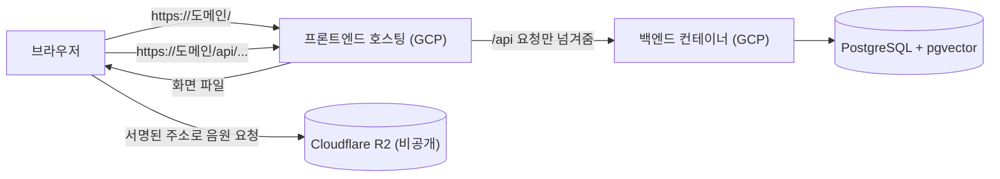
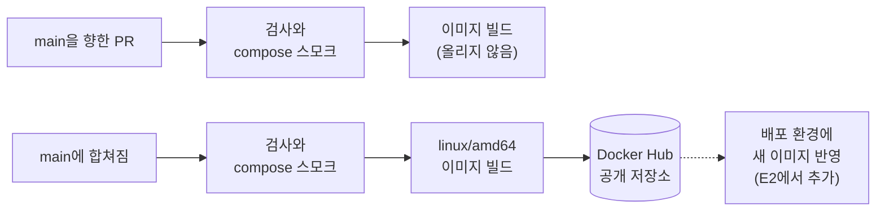

# 인프라

이 문서는 배포 환경에 관한 내용을 다룹니다. 배포의 큰 틀은 정해졌습니다. 백엔드는 Docker 컨테이너로 배포하고, `main` 브랜치에 합쳐진 코드를 자동으로 배포합니다([ADR-010](ADR.md#adr-010-배포-방식)). 그리고 프론트엔드와 백엔드는 GCP에, 음원은 Cloudflare R2에 두며, 도메인은 Cloudflare에서 삽니다([ADR-023](ADR.md#adr-023-배포-인프라)). 이 문서는 1절과 2절에 정해진 것을 적고, 3절에 아직 정해야 하는 것과 정할 때 따져 보아야 할 점을 적습니다.

## 1. 지금까지 정해진 것

| 항목 | 내용 |
| --- | --- |
| 배포 단위 | 백엔드는 Docker 컨테이너 하나로 배포합니다. |
| 로컬 개발 환경 | Docker Compose로 API 서버와 PostgreSQL을 함께 띄웁니다. 띄우는 방법은 [README](../README.md)에 있습니다. |
| 로컬의 마이그레이션 | compose의 일회성 서비스 `migrate`가 실행하고, API 서버는 그 서비스가 성공한 뒤에 뜹니다([ADR-015](ADR.md#adr-015-로컬-실행-구성과-헬스체크)). |
| 자동 배포 | 코드가 `main` 브랜치에 합쳐지면 자동으로 컨테이너 이미지를 만들어 배포합니다. 자세한 내용은 [3.7절](#37-자동-배포)에 있습니다. |
| 컨테이너 이미지의 보관 | 만든 이미지는 Docker Hub의 공개 저장소에 저장하며, `linux/amd64` 이미지만 올립니다([ADR-014](ADR.md#adr-014-ci-검사와-컨테이너-이미지)). |
| 프론트엔드와 백엔드를 올릴 곳 | 둘 다 GCP에 올립니다. 각각을 GCP의 어느 서비스에 올릴지는 [3.1절](#31-백엔드를-gcp의-어느-서비스에-올릴-것인가)에서 정합니다. |
| 같은 도메인 조건을 맞추는 방식 | 프론트엔드의 호스팅이 `/api`로 시작하는 요청을 백엔드로 넘겨줍니다. 자세한 내용은 [2.1절](#21-주소-하나를-함께-쓰는-구성)에 있습니다. |
| 도메인 | Cloudflare에서 삽니다. |
| 음원 저장소 | Cloudflare R2를 씁니다. 저장소는 비공개로 두고, 백엔드가 발급한 서명된 주소로만 음원을 받을 수 있게 합니다. |
| 음원의 라이선스 | 현재는 퍼블릭 도메인이거나 저작권의 제약이 없는 음원만 씁니다. |
| 로그인이 동작하는 곳 | 배포를 연결하는 Epic(E2) 전에는 로컬에서, 그 뒤에는 로컬과 GCP의 운영 주소에서 Google 로그인이 동작해야 합니다. |
| 프로젝트의 성격 | 포트폴리오용이며 창업 계획은 없습니다. 따라서 비용을 거의 들이지 않는 것이 우선입니다. |

## 2. 반드시 충족해야 하는 조건

어떤 서비스를 고르더라도 아래 조건은 지켜야 합니다. 이 조건들은 이미 내린 다른 결정에서 따라 나온 것입니다.

| 조건 | 이유 |
| --- | --- |
| 프론트엔드와 백엔드가 같은 도메인 아래에 있어야 합니다. | 로그인 상태를 쿠키로 주고받기 때문입니다([ADR-006](ADR.md#adr-006-로그인과-접근-제한)). 도메인이 서로 다르면 Safari 같은 브라우저가 쿠키를 막을 수 있습니다. |
| PostgreSQL에서 pgvector 확장 기능을 쓸 수 있어야 합니다. | 벡터 검색을 PostgreSQL 안에서 하기 때문입니다([ADR-002](ADR.md#adr-002-데이터베이스와-벡터-검색)). |
| 모든 통신이 HTTPS여야 합니다. | 로그인 쿠키를 안전하게 보내기 위해서이며, Google 로그인도 HTTPS 주소를 요구합니다. |
| 오브젝트 저장소가 비공개 보관과 서명된 주소의 발급을 지원해야 합니다. | 음원 파일은 백엔드가 발급한 서명된 주소로만 받을 수 있어야 하기 때문입니다([ARCHITECTURE.md](ARCHITECTURE.md#2-전체-구성)). 서명된 주소는 정해진 시간 동안만 유효한 임시 주소이며, 브라우저는 이 주소로 저장소에서 음원을 직접 받습니다. Cloudflare R2는 이 조건을 충족합니다. |

### 2.1 주소 하나를 함께 쓰는 구성

같은 도메인 조건은 프론트엔드와 백엔드가 주소 하나를 함께 쓰는 구성으로 맞춥니다. 프론트엔드를 호스팅하는 서비스가 `/api`로 시작하는 요청만 백엔드로 넘겨주도록 설정하는 방식입니다. 이렇게 하면 브라우저가 보기에는 프론트엔드와 백엔드의 주소가 완전히 같습니다. 그래서 백엔드에 CORS 설정이 필요 없고, 프론트엔드가 지금 쓰고 있는 `/api` 경로를 그대로 쓸 수 있습니다.

이 구성이 동작하려면 프론트엔드를 올리는 GCP 서비스가 요청을 넘겨주는 기능을 지원해야 합니다. 예를 들어 Firebase Hosting은 정해진 경로의 요청을 Cloud Run 서비스로 넘겨줄 수 있습니다. 그러므로 프론트엔드를 올릴 서비스와 백엔드를 올릴 서비스는 함께 정해야 합니다(3.1절).

## 3. 정해야 할 항목과 고려사항

### 3.1 백엔드를 GCP의 어느 서비스에 올릴 것인가

| 선택지 | 장점 | 따져 볼 점 |
| --- | --- | --- |
| 컨테이너를 올리면 알아서 실행해 주는 서비스 (Cloud Run) | 서버를 직접 관리하지 않아도 되고, 요청이 없을 때에는 비용이 거의 들지 않습니다. Firebase Hosting이 `/api` 요청을 넘겨줄 수 있는 대상입니다. | 한동안 요청이 없다가 다시 들어오면 첫 응답이 느릴 수 있습니다. 페이지를 넘길 때의 위치 알림이 느려지지 않는지 확인해야 합니다. |
| 가상 서버 한 대에 Docker Compose로 전부 올리기 (Compute Engine의 무료 등급) | API 서버와 데이터베이스를 한 대에 올릴 수 있어서 비용이 가장 적게 듭니다. | 서버의 보안 업데이트, 백업, 장애 복구를 직접 챙겨야 합니다. 무료 등급 서버는 메모리가 작아서 PostgreSQL과 함께 돌리기에 충분한지 확인해야 합니다. 그리고 프론트엔드의 호스팅이 이 서버로 `/api` 요청을 넘겨줄 수 있는지 확인해야 합니다. |

어느 쪽을 고르든 아래 두 가지를 확인해야 합니다. 구체적인 숫자는 자주 바뀌므로, 결정하는 시점에 GCP의 공식 안내를 직접 확인합니다.

- **요청 본문의 크기 제한**: 관리자가 올리는 산출물 묶음은 요청 하나에 담기며, 설정값 `BUNDLE_MAX_SIZE_MB`의 기본값은 200MB입니다([CONFIGURATION.md](CONFIGURATION.md#36-묶음-적재)). 그런데 Cloud Run은 HTTP/1 요청의 본문 크기에 제한(현재 32MiB로 알려져 있음)이 있습니다. 실제 묶음의 크기가 이 제한 안에 드는지, 넘는다면 어떻게 올릴지를 정해야 합니다.
- **요청 시간 제한**: 묶음 적재는 요청 안에서 끝내고 결과를 바로 응답합니다([ADR-019](ADR.md#adr-019-정확-검색과-동기-적재)). 그런데 Firebase Hosting이 넘겨주는 요청에는 시간 제한(현재 60초로 알려져 있음)이 있습니다. 적재가 이 시간 안에 끝나는지 확인해야 합니다.

### 3.2 PostgreSQL을 어디에 둘 것인가

| 선택지의 유형 | 장점 | 따져 볼 점 |
| --- | --- | --- |
| 클라우드의 관리형 데이터베이스 (예: Cloud SQL) | 백업과 업데이트를 서비스가 대신 해 줍니다. | 전체 비용에서 가장 큰 부분을 차지할 가능성이 높습니다. 무료 크레딧이 끝난 뒤의 월 비용을 미리 계산해야 합니다. |
| 무료 범위가 있는 PostgreSQL 전문 서비스 (예: Neon, Supabase) | 비용이 들지 않고 pgvector를 지원합니다. | 저장 용량의 한도가 벡터와 평가 기록을 담기에 충분한지, 한동안 쓰지 않으면 잠드는지 확인해야 합니다. 그리고 GCP의 백엔드와 다른 곳에 있으므로 둘 사이의 지연 시간을 확인해야 합니다. |
| API 서버와 같은 가상 서버에 직접 설치 | 추가 비용이 없습니다. | 백업을 직접 구성해야 합니다. 평가 기록은 다시 만들 수 없는 자료이므로 백업이 특히 중요합니다. |

### 3.3 음원 저장소(Cloudflare R2)에서 정할 것

- 음악 목록의 규모가 정해져야 필요한 저장 용량을 계산할 수 있습니다. 이 규모는 AI팀이 정합니다.
- R2는 전송량에 요금을 매기지 않지만 요청 수에는 요금을 매깁니다. 테스트 기간의 재생 횟수가 무료 범위 안에 드는지 확인해야 합니다.
- 브라우저가 곡의 중간부터 재생할 수 있으려면 저장소가 "파일의 일부분만 요청하기"(HTTP Range 요청)를 서명된 주소에서도 지원해야 합니다. E5에서 실제로 확인합니다.
- 브라우저의 웹 페이지가 다른 주소에 있는 저장소에서 음원을 받아 재생하려면, 저장소 쪽에 프론트엔드의 주소를 허용하는 설정(CORS)이 필요할 수 있습니다. 프론트엔드가 음원을 어떤 방식으로 재생하는지에 따라 달라지므로 함께 확인해야 합니다.
- AI팀이 음원 파일을 저장소에 올릴 방법과 권한을 정해야 합니다. 저장소가 비공개이므로, 올리는 사람에게 저장소의 쓰기 권한을 주는 방법과 관리자 API가 올리기 전용의 서명된 주소를 발급해 주는 방법 가운데 하나를 골라야 합니다.

### 3.4 도메인과 HTTPS

- Cloudflare에서 산 도메인을 프론트엔드의 호스팅에 연결해야 합니다. DNS 기록은 Cloudflare에서 관리합니다.
- HTTPS 인증서는 프론트엔드의 호스팅이 발급합니다. 이때 Cloudflare의 프록시 기능을 켜면 호스팅의 인증서 발급과 부딪힐 수 있으므로, 프록시를 켤지 확인해야 합니다.

### 3.5 Google 로그인 설정

- Google Cloud 콘솔에서 로그인용 클라이언트를 만들고, 로그인 뒤에 돌아올 주소(`/api/auth/google/callback`)를 로컬의 주소와 운영 주소 모두에 대해 등록해야 합니다. 클라이언트를 어느 계정으로 만들지는 팀장과 백엔드 담당자가 정합니다.
- 로그인 동의 화면은 "테스트" 상태로 둡니다. 이 상태에서는 콘솔에 테스터로 등록한 계정만 로그인할 수 있습니다. 테스터는 실사용 테스트 직전에 인원을 확정한 뒤 콘솔에서 직접 등록합니다([DECISIONS.md](DECISIONS.md)의 D-53).
- 그래서 테스트에 참여하는 사람은 두 목록에 모두 있어야 합니다. 하나는 Google 콘솔의 테스터 목록이고, 다른 하나는 백엔드의 허용 목록입니다([API.md 4.10절](API.md#410-관리자-허용-목록)). 앞의 목록에 없으면 Google 로그인 단계에서 막히고, 뒤의 목록에 없으면 로그인한 뒤 `/login?error=NOT_ALLOWED`로 보내집니다.

### 3.6 비밀값 관리

- 데이터베이스 비밀번호, Google 로그인의 비밀값, R2의 접속 정보 같은 값은 코드 저장소에 올리지 않습니다.
- 배포 환경에서 이 값들을 어디에 보관하고 컨테이너에 어떻게 전달할지 정해야 합니다. 설정값의 목록은 [CONFIGURATION.md](CONFIGURATION.md)에 있습니다.

### 3.7 자동 배포

자동 배포의 방식은 아래와 같이 정했습니다. 검사부터 이미지를 Docker Hub에 올리는 단계까지는 Epic 0에서 `.github/workflows/ci.yml`로 만들었고, 배포 환경에 새 이미지를 반영하는 단계는 배포를 연결하는 Epic(E2)에서 추가합니다.

- `main`을 향한 PR에서는 검사(`scripts/check.sh`)와 compose 스모크를 돌리고, 이미지가 빌드되는지까지만 확인합니다. 이미지를 올리지는 않습니다([ADR-014](ADR.md#adr-014-ci-검사와-컨테이너-이미지)).
- 코드가 `main`에 합쳐지면 같은 검사와 스모크를 다시 돌리고, 둘 다 통과한 뒤에만 이미지를 만들어 Docker Hub에 올립니다. 태그는 `latest`와 `sha-<커밋>`의 두 가지입니다.
- PR을 합치는 관문은 `main`의 ruleset입니다. PR을 거쳐야만 합칠 수 있고, CI의 검사가 통과해야 합니다(D-38).
- Docker Hub에 올릴 때 쓰는 값은 아래와 같이 GitHub에 등록합니다. 이 값들은 코드에 적지 않습니다(ADR-014).

| 종류 | 이름 | 값 |
| --- | --- | --- |
| secret | `DOCKERHUB_USERNAME` | Docker Hub의 사용자 이름 |
| secret | `DOCKERHUB_TOKEN` | Docker Hub에서 발급한, Read & Write 권한을 가진 액세스 토큰 |
| variable | `DOCKERHUB_IMAGE` | 이미지의 전체 이름. 예를 들면 `<사용자 이름>/diegesis-be`와 같습니다. |

그리고 아래 항목은 백엔드를 올릴 서비스가 정해져야 정할 수 있어서 아직 남아 있습니다.

- 배포 환경이 Docker Hub의 새 이미지를 어떤 방법으로 가져와 실행할지 정해야 합니다. 이 방법은 3.1절에서 고르는 서비스에 따라 달라집니다.
- 배포 환경은 `latest`가 아니라 `sha-<커밋>` 태그로 새 이미지를 가져와야 합니다. `main`에 거의 동시에 두 번 합쳐지면 두 CI 실행이 서로를 기다리지 않으므로, `latest`가 더 오래된 커밋의 이미지를 가리킬 수 있기 때문입니다.
- 데이터베이스 구조를 바꾸는 작업(마이그레이션)을 배포 과정의 어느 시점에 실행할지 정해야 합니다. 로컬에서는 일회성 서비스로 실행합니다(ADR-015).
- 배포 환경이 준비 상태 확인을 요구하면, 데이터베이스까지 확인하는 엔드포인트를 만들어야 합니다(ADR-015).
- 배포 환경의 서버가 `arm64`라면 그 CPU 아키텍처의 이미지도 올려야 합니다(ADR-014).
- 배포에 필요한 비밀값을 GitHub의 비밀값 저장 기능에 등록해야 합니다.

### 3.8 백업과 로그

- 평가 기록은 MVP의 가장 중요한 결과물이므로, 데이터베이스를 얼마나 자주 백업하고 어디에 보관할지 정해야 합니다.
- 서버의 로그를 어디에서 볼지, 오류가 났을 때 알림을 받을지 정해야 합니다.

### 3.9 GCP 무료 크레딧을 쓸 경우에 따져 볼 점

GCP의 무료 크레딧으로 비용을 감당한다면 아래 내용을 추가로 확인해야 합니다. 무료 범위의 구체적인 숫자는 자주 바뀌므로, 결정하는 시점에 GCP의 공식 안내를 직접 확인해야 합니다.

- 신규 계정에 주는 무료 크레딧의 금액과 사용 기한을 확인해야 합니다.
- 크레딧과 무관하게 계속 무료인 범위가 무엇인지, 그리고 그 범위가 서울 리전에서도 적용되는지 확인해야 합니다. 무료 범위가 특정 미국 리전에만 적용된다면 한국에서의 응답 속도가 느려질 수 있습니다.
- 계정을 옮길 일이 생기면 옮겨야 하는 것은 컨테이너 이미지, 데이터베이스의 내용, 비밀값, 도메인 연결, Google 로그인 설정입니다. 음원 파일은 Cloudflare R2에 있으므로 옮기지 않아도 됩니다. 데이터베이스의 내용을 옮기는 절차는 미리 문서로 만들어 두어야 합니다.
- 실사용 테스트 기간(2026년 12월 21일부터 27일까지) 도중에 계정을 옮기는 일이 생기지 않도록 크레딧의 기한을 일정과 맞춰야 합니다.

## 4. 결정에 필요한 정보와 그 정보를 가진 사람

| 필요한 정보 | 알려 줄 사람 |
| --- | --- |
| 프론트엔드를 GCP의 어느 서비스에 올릴지, 그리고 그 서비스가 `/api` 요청을 어디로 넘겨줄 수 있는지 | 프론트엔드 담당 |
| 음악 목록의 규모, 음원 파일의 형식, 산출물 묶음의 실제 크기 | AI팀 |
| 쓸 수 있는 예산과 계정, Google 로그인 클라이언트를 만들 계정 | 팀 전체, 팀장 |
